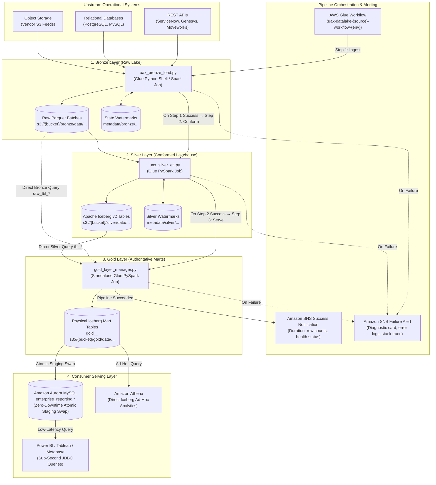

# Enterprise Medallion Data Lakehouse Platform

An enterprise-grade, config-driven Medallion Lakehouse platform built on **AWS Glue**, **Apache Iceberg (v2)**, **AWS Secrets Manager**, **Amazon Athena**, and **Amazon Aurora MySQL**. The platform delivers high-throughput incremental ingestion, conformed dimensional transformation, cross-layer analytical marts, and zero-downtime operational serving orchestrated by **AWS Glue Workflows** with automated **Amazon SNS success/failure notifications**.

---

## 🏗️ Architectural Overview

The platform implements the **Medallion Lakehouse Architecture** (`Bronze` $\to$ `Silver` $\to$ `Gold (Authoritative Iceberg Table)` $\to$ `Consumer Serving Layer`). 

An **AWS Glue Workflow** (`uax-datalake-{source}-workflow-{env}`) orchestrates the pipeline, executing all **three Glue jobs sequentially, one by one**. After completion, automated notification logic emits an **Amazon SNS Success Message** with run statistics or an **Amazon SNS Failure Alert** with complete diagnostic details.



---

## 📚 Comprehensive Documentation Suite

For granular engineering specifications, execution lifecycles, configuration blueprints, and developer guides, refer to the documentation suite in [`docs/`](docs/):

| Layer / Topic | Documentation Link | Description |
| :--- | :--- | :--- |
| **System Architecture** | [Architecture Blueprint](docs/ARCHITECTURE.md) | Universal architectural specification, sequential Glue Workflow, cross-layer security, and alerting. |
| **Bronze Layer** | [Bronze Low-Level Guide](docs/bronze/BRONZE_LAYER.md) | Ingestion mechanics, connector protocols, OAuth2 grant types, and S3 state watermarks. |
| **Bronze Config** | [Bronze Config Blueprint](docs/bronze/CONFIG_BLUEPRINT.md) | Line-by-line configuration parameter blueprint and source connection templates. |
| **Silver Layer** | [Silver Low-Level Guide](docs/silver/SILVER_LAYER.md) | Apache Iceberg v2 storage, deduplication windowing, SCD1, SCD2, and schema evolution. |
| **Silver Config** | [Silver Config Blueprint](docs/silver/CONFIG_BLUEPRINT.md) | Declarative transformation, deduplication, and Iceberg table configuration reference. |
| **Gold Layer** | [Gold Low-Level Guide](docs/gold/GOLD_LAYER.md) | Standalone Glue PySpark job, cross-layer queries (`raw_tbl_*`, `tbl_*`, `gold_*`), physical Iceberg tables, ghost table recovery, and Aurora MySQL atomic swap. |
| **Gold Config** | [Gold Config Blueprint](docs/gold/CONFIG_BLUEPRINT.md) | Business mart definition, SQL linkage, natural keys, and Aurora MySQL adapter configuration reference. |
| **Developer Onboarding** | [Onboarding & Operations Guide](docs/ONBOARDING_GUIDE.md) | Environment setup, Glue Workflow execution, Secrets Manager schemas, and step-by-step entity addition. |
| **Lambda & Tooling Helper** | [Lambda Helper Guide](lambda_helper/HELPER.md) | Centralized control plane for Athena ad-hoc queries, Glue Workflow monitoring, and catalog maintenance. |

---

## 📁 Repository Directory Structure

```text
Data-pipeline/
├── bronze/                             # Bronze Ingestion Engine
│   └── script/
│       ├── config/
│       │   └── bronze_config.json      # Ingestion configuration blueprint
│       ├── connectors/                 # Modular upstream connectors
│       │   ├── __init__.py             # Connector registry & CONNECTOR_MAP
│       │   ├── database.py             # Relational database streaming connector
│       │   ├── genesys.py              # Genesys Cloud Analytics API connector
│       │   ├── http_client.py          # Resilient HTTP client with retry & rate limiting
│       │   ├── moveworks.py            # Moveworks Enterprise API connector
│       │   ├── oauth.py                # OAuth2 client (client_credentials, password, refresh)
│       │   ├── s3_file.py              # S3 file feed connector (CSV, JSON, Parquet)
│       │   └── servicenow.py           # ServiceNow REST Table API connector
│       ├── config_loader.py            # Centralized config parser & {env} interpolator
│       ├── protegrity_encryption.py    # Protegrity PII tokenization & REST API batch encryptor
│       └── uax_bronze_load.py          # Main Bronze execution script (Glue Python Shell)
├── silver/                             # Silver Conformation & Iceberg Engine
│   └── script/
│       ├── config/
│       │   └── silver_config.json      # Silver transformation & Iceberg merge configuration
│       ├── custom_transforms/          # Pluggable PySpark transformation scripts
│       │   ├── __init__.py
│       │   ├── moveworks_conversations.py
│       │   ├── moveworks_interactions.py
│       │   ├── moveworks_plugin_calls.py
│       │   ├── moveworks_plugin_resources.py
│       │   ├── moveworks_users.py
│       │   └── servicenow_incident.py
│       ├── silver_config_loader.py     # Silver config parser & cache manager
│       ├── transformer.py              # Declarative transformation rules engine
│       └── uax_silver_etl.py           # Main Silver PySpark Iceberg execution script
├── gold/                               # Gold Analytics Marts & Serving Engine
│   ├── query/                          # Business SQL transformation queries
│   │   ├── genesys/                    # Genesys SQL queries (conversations.sql)
│   │   ├── moveworks/                  # Moveworks SQL queries (interactions.sql, feedbacks.sql)
│   │   └── servicenow/                 # ServiceNow SQL queries (incident_kpi.sql)
│   └── script/
│       ├── config/
│       │   └── gold_config.json        # Gold serving configuration blueprint
│       ├── custom_transforms/          # Domain-specific PySpark transformation hooks
│       │   └── genesys_conversations.py
│       ├── gold_config_loader.py       # Gold configuration loader & cache manager
│       ├── gold_initial_load.py        # Gold initial load & PySpark distributed encryptor
│       ├── gold_layer_manager.py       # Master Gold orchestration engine & standalone Glue job entrypoint
│       └── protegrity_encryption.py    # Protegrity PII tokenization & PySpark mapInPandas batch encryptor
├── lambda_helper/                      # Operations & Query Helper Lambda
│   ├── lambda_function.py              # Unified Lambda handler (Athena queries, Glue workflows, multi-stage pipelines)
│   └── HELPER.md                       # Comprehensive event payload & operations guide
├── terraform/                          # Infrastructure as Code
│   ├── 1_bronze/                       # Bronze S3 bucket, IAM, and Glue job Terraform
│   ├── 2_silver/                       # Silver Glue job & Iceberg catalog Terraform
│   ├── 3_athena/                       # Athena workgroup & query output Terraform
│   ├── 4_step_functions/               # SNS topics, Step Functions & alerts Terraform
│   └── 5_gold/                         # Gold Glue job, VPC connection & Aurora integration Terraform
└── docs/                               # Enterprise Documentation Suite
    ├── ARCHITECTURE.md                 # System-wide architectural blueprint
    ├── ONBOARDING_GUIDE.md             # Developer setup, Glue job args & onboarding recipe
    ├── bronze/                         # Bronze low-level documentation
    ├── silver/                         # Silver low-level documentation
    └── gold/                           # Gold low-level documentation
```

---

## 🚀 Execution & Orchestration

### 1. Master Pipeline: AWS Glue Workflow (Sequential 3-Job DAG)

The recommended operational execution triggers an **AWS Glue Workflow**, which runs the 3 Glue jobs sequentially one by one and emits an automated **Amazon SNS** notification upon pipeline success or failure:

```bash
aws glue start-workflow-run \
  --name "uax-datalake-moveworks-workflow-dev" \
  --run-properties '{
    "ENV": "dev",
    "SOURCE_SYSTEM": "moveworks"
  }'
```

```
AWS Glue Workflow: uax-datalake-{source}-workflow-{env}
        │
        ▼
[Job 1: Bronze Ingestion]      ──► uax_bronze_load.py
        │ SUCCESS
        ▼
[Job 2: Silver Conformance]    ──► uax_silver_etl.py
        │ SUCCESS
        ▼
[Job 3: Gold Marts & Serving]  ──► gold_layer_manager.py
        │ SUCCESS
        ▼
[Notification: Pipeline Success] ──► Amazon SNS Success Notification (records, durations)
        │
        └── ANY JOB FAILURE     ──► Amazon SNS Failure Alert + Error Diagnostic Card
```

---

### 2. Standalone Glue Job Runs

Each layer can also be triggered independently for ad-hoc backfills or targeted reprocessing. Parameters follow a strict hierarchy: **Glue Job Arguments (`--KEY value`) take top priority; if omitted, the job resolves parameters from its JSON configuration.**

#### A. Ingest Raw Data (Bronze — AWS Glue Python Shell)
```bash
aws glue start-job-run \
  --job-name "glue-bronze-servicenow-dev" \
  --arguments '{
    "--JOB_NAME": "glue-bronze-servicenow-dev",
    "--SOURCE_SYSTEM": "servicenow",
    "--ENV": "dev",
    "--SOURCE_TABLE_NAME": "incident",
    "--CONFIG_S3_PATH": "s3://uax-datalake-config-dev/bronze/config/bronze_config.json"
  }'
```
* **Mandatory Glue Arguments:** `--JOB_NAME`, `--SOURCE_SYSTEM`.
* **Optional Glue Arguments (Fallback to `bronze_config.json`):** `--ENV` (default: `dev`), `--CONFIG_S3_PATH`, `--SOURCE_TABLE_NAME`, `--BRONZE_BUCKET`, `--STATE_BUCKET`, `--SECRET_NAME`, `--BATCH_SIZE`, `--INITIAL_LOAD_DATE`, `--UPPER_BOUND`, `--FLATTEN_NESTED_JSON`, `--ERROR_HANDLING_MODE`.

---

#### B. Conform & Merge to Apache Iceberg (Silver — AWS Glue PySpark)
```bash
aws glue start-job-run \
  --job-name "glue-silver-servicenow-dev" \
  --arguments '{
    "--JOB_NAME": "glue-silver-servicenow-dev",
    "--SOURCE_SYSTEM": "servicenow",
    "--ENV": "dev",
    "--SOURCE_TABLE_NAME": "tbl_incident",
    "--CONFIG_S3_PATH": "s3://uax-datalake-config-dev/silver/config/silver_config.json"
  }'
```
* **Mandatory Glue Arguments:** `--JOB_NAME`, `--SOURCE_SYSTEM`.
* **Optional Glue Arguments (Fallback to `silver_config.json`):** `--ENV` (default: `dev`), `--CONFIG_S3_PATH`, `--SOURCE_TABLE_NAME`, `--DATA_LAKE_BUCKET`, `--GLUE_DATABASE`, `--TABLE_PREFIX`, `--BRONZE_DATA_PREFIX`, `--SILVER_DATA_PREFIX`, `--FULL_REFRESH`, `--INCREMENTAL`.

---

#### C. Build Marts & Sync Serving Targets (Gold — AWS Glue PySpark)
```bash
aws glue start-job-run \
  --job-name "glue-gold-moveworks-dev" \
  --arguments '{
    "--JOB_NAME": "glue-gold-moveworks-dev",
    "--SOURCE_SYSTEM": "moveworks",
    "--ENV": "dev",
    "--TABLE_NAME": "interactions",
    "--GOLD_SCHEMA": "enterprise_reporting",
    "--RDS_SECRET_NAME": "uax-datalake/aurora-credentials-dev",
    "--GOLD_CONFIG_S3_PATH": "s3://uax-datalake-config-dev/gold/config/gold_config.json"
  }'
```
* **Mandatory Glue Arguments:** `--JOB_NAME`, `--SOURCE_SYSTEM`.
* **Required for Aurora MySQL Serving:** `--GOLD_SCHEMA` (or `aurora.schema` in `gold_config.json` — zero fallback allowed by policy).
* **Optional Glue Arguments (Fallback to `gold_config.json`):** `--ENV` (default: `dev`), `--GOLD_CONFIG_S3_PATH`, `--TABLE_NAME`, `--DATA_LAKE_BUCKET`, `--GLUE_DATABASE`, `--RDS_SECRET_NAME`, `--GOLD_TARGETS` (`athena,aurora`), `--FULL_REFRESH`, `--INCREMENTAL`.

For complete configuration blueprints, operational procedures, and step-by-step entity onboarding, consult the [Onboarding & Operations Guide](docs/ONBOARDING_GUIDE.md).
