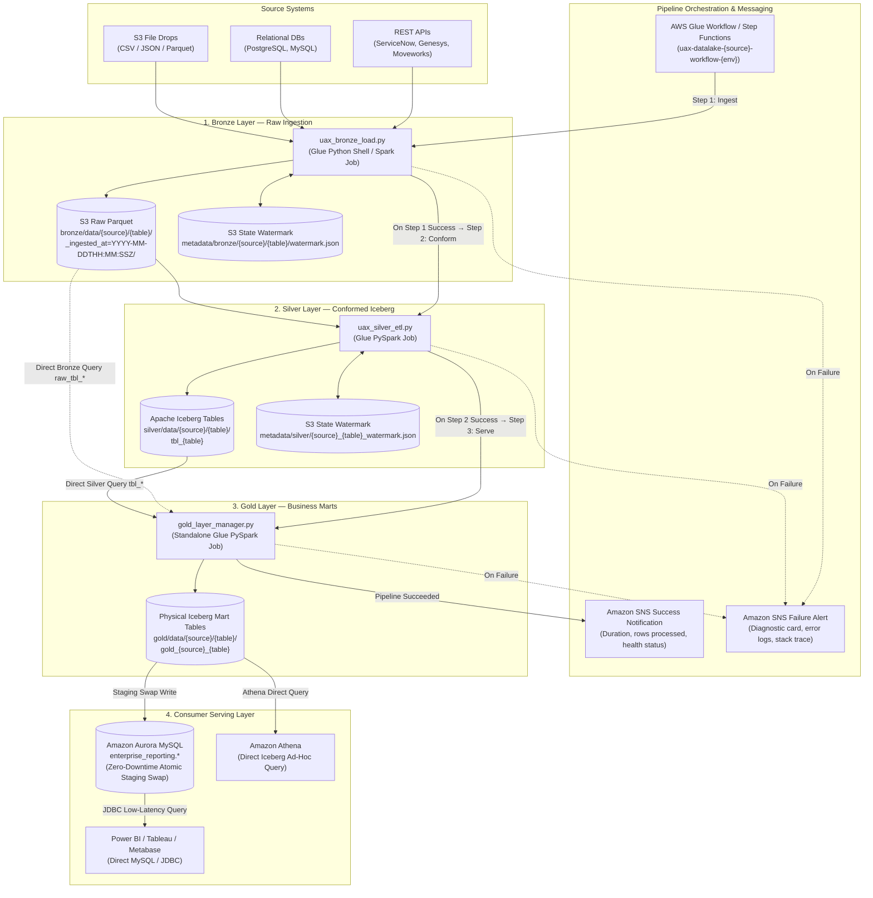
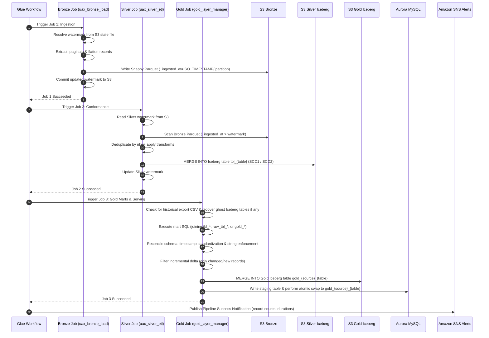

# UAX DataLake — End-to-End Architecture

> **Project:** UAX DataLake  
> **Pattern:** Medallion (Multi-Hop) Lakehouse Architecture — Bronze → Silver → Gold → Consumer  
> **Orchestration:** AWS Glue Workflow (with Step Functions / EventBridge / Lambda options)  
> **Notification:** Amazon SNS Success / Failure Alert Messaging  

---

## 1. High-Level Overview

UAX DataLake ingests operational data from multiple enterprise source systems, refines it through three isolated processing layers, and serves business-ready data marts to downstream analytics and BI tools.

Each layer runs as an independent AWS Glue job. An **AWS Glue Workflow** orchestrates the end-to-end execution, triggering all **three Glue jobs sequentially, one by one**. After completion, an automated messaging step sends a **Success Notification** with execution metrics or a **Failure Alert** with full diagnostic details.



---

## 2. Orchestration & Alerting: AWS Glue Workflow

### 2.1 Sequential 3-Job Pipeline Execution

The pipeline is organized as a directed acyclic graph (DAG) inside an **AWS Glue Workflow** (`uax-datalake-{source}-workflow-{env}`):

```
AWS Glue Workflow Trigger
        │
        ▼
[Job 1: Bronze Ingestion]      ──► uax_bronze_load.py (uax-datalake-bronze-ingestion-{env})
        │ SUCCESS
        ▼
[Job 2: Silver Conformance]    ──► uax_silver_etl.py (uax-datalake-silver-etl-{env})
        │ SUCCESS
        ▼
[Job 3: Gold Marts & Serving]  ──► gold_layer_manager.py (uax-datalake-gold-marts-{env})
        │ SUCCESS
        ▼
[Notification: Pipeline Success] ──► Amazon SNS Success Notification (Email / Teams / Slack)
        │
        └── ANY JOB FAILURE     ──► Amazon SNS Failure Alert + Structured Diagnostic Card
```

### 2.2 Why Sequential (One by One) Execution?

| Architectural Factor | Benefit & Guarantees |
|---|---|
| **Data Dependency** | Silver requires completed Bronze Parquet batches. Gold requires conformed Silver Iceberg tables. Enforcing sequential execution guarantees data completeness. |
| **Watermark Integrity** | Each layer commits its watermark state to S3 only upon successful write completion. |
| **Cross-Layer SQL Support** | Gold queries can query across any layer (`raw_tbl_*`, `tbl_*`, `gold_*`). Ensuring upstream jobs complete first prevents reading stale partitions. |
| **Failure Isolation & Cost Control** | If Bronze fails, Silver and Gold do not run, preventing unnecessary compute costs and downstream corruption. |

### 2.3 Post-Execution Messaging: Success & Failure Notifications

At the conclusion of the workflow run:
1. **Success Notification**: Emits an Amazon SNS message containing:
   - Pipeline run status (`SUCCESS`)
   - Source system and execution environment
   - Total records ingested, conformed, and served across all tables
   - Execution duration breakdown for each of the 3 jobs
2. **Failure Alert**: If any of the 3 Glue jobs fail:
   - Emits a high-priority SNS alert to the on-call data engineering distribution list
   - Includes the structured Error Diagnostic Card: failing layer, step name, error class, error message, and direct CloudWatch log URI.

---

## 3. Layer Summary

| Layer | Job Script | Input | Output | Storage & Catalog |
|---|---|---|---|---|
| **Bronze** | `uax_bronze_load.py` | REST APIs / DBs / S3 Files | Append-only Parquet — single `_ingested_at` ISO timestamp partition per run | S3 `bronze/data/` |
| **Silver** | `uax_silver_etl.py` | Bronze Parquet (incremental) | Apache Iceberg v2 tables (`tbl_<name>`) (ACID upsert / SCD1 / SCD2) | S3 `silver/data/` + Glue Catalog |
| **Gold** | `gold_layer_manager.py` | Silver Iceberg (`tbl_*`), Bronze (`raw_tbl_*`), Gold (`gold_*`) | Physical Iceberg Marts (`gold_<source>_<name>`) (Authoritative Source of Truth) | S3 `gold/data/` + Glue Catalog |
| **Consumer** | _(Gold job — serving phase)_ | Gold Iceberg Marts | Aurora MySQL reporting tables (`gold_*`) via zero-downtime atomic swap | Amazon Aurora MySQL `enterprise_reporting.*` |

---

## 4. End-to-End Sequence



---

## 5. Layer Responsibilities & Low-Level Code Details

### 5.1 Bronze — Raw Ingestion (`uax_bronze_load.py`)

The Bronze layer runs as an **AWS Glue Python Shell job** — not PySpark. It uses `boto3` and `pandas` entirely in-process, keeping the runtime lightweight and eliminating Spark startup overhead for API and file-based workloads. Every design decision in this layer serves a single principle: **no data loss, no duplicate writes, no partial states.**

#### 5.1.1 Parameter Resolution — 3-Tier Precedence & Glue Arguments

Before extraction begins, `parse_arguments()` resolves every operating parameter through a strict three-tier chain:

```
1. AWS Glue Job Arguments (--KEY value)         ← highest priority (overrides config)
2. JSON Configuration File (loaded from S3)     ← second priority (default pipeline blueprint)
3. Code Hardcoded Defaults                     ← lowest priority (safe baseline fallbacks)
```

The config file is fetched once from S3 via `ConfigLoader.load_config()`, with all `{env}` placeholders substituted at load time. Bucket names, data prefixes, table lists, and catalog settings are all resolved from this merged context before any connector is initialised.

##### Glue Arguments Contract Across Layers:

| Layer | Mandatory Glue Arguments | Optional Glue Arguments (Fallback to Config) |
|---|---|---|
| **Bronze** (`uax_bronze_load.py`) | `--JOB_NAME`<br>`--SOURCE_SYSTEM` | `--ENV` (default: `dev`), `--CONFIG_S3_PATH`, `--SOURCE_TABLE_NAME` (all tables under source if omitted), `--BRONZE_BUCKET`, `--STATE_BUCKET`, `--SECRET_NAME`, `--BATCH_SIZE`, `--INITIAL_LOAD_DATE`, `--UPPER_BOUND`, `--FLATTEN_NESTED_JSON`, `--ERROR_HANDLING_MODE` |
| **Silver** (`uax_silver_etl.py`) | `--JOB_NAME`<br>`--SOURCE_SYSTEM` | `--ENV` (default: `dev`), `--CONFIG_S3_PATH`, `--SOURCE_TABLE_NAME` (all tables under source if omitted), `--PROCESS_LAYER` (`silver`), `--DATA_LAKE_BUCKET`, `--GLUE_DATABASE`, `--TABLE_PREFIX`, `--BRONZE_DATA_PREFIX`, `--SILVER_DATA_PREFIX`, `--FULL_REFRESH`, `--INCREMENTAL` |
| **Gold** (`gold_layer_manager.py`) | `--JOB_NAME`<br>`--SOURCE_SYSTEM` | `--ENV` (default: `dev`), `--GOLD_CONFIG_S3_PATH`, `--TABLE_NAME`, `--RDS_GOLD_SCHEMA` (or `--GOLD_SCHEMA` — **mandatory for RDS/Aurora**), `--CONNECTION_NAME`, `--DATA_LAKE_BUCKET`, `--GLUE_DATABASE`, `--GOLD_TARGETS`, `--FULL_REFRESH`, `--INCREMENTAL` |

#### 5.1.2 Watermark State — Incremental Load Guard

Each source table maintains its own JSON state file in S3:

```
s3://<state-bucket>/metadata/bronze/<source>/<table>/watermark.json
```

The state file records the last successfully written `_ingested_at` timestamp. The job reads it before extraction and passes it as the lower bound to the connector's query or API filter.

```json
{
  "last_load_date": "2024-06-01T06:00:00Z",
  "source_system": "moveworks",
  "table_name": "conversations",
  "records_ingested": 4823,
  "updated_at": "2024-06-01T06:12:44Z"
}
```

If the state file is absent, the job falls back to `table_initial_load_dates` in `bronze_config.json`. If that too is absent, the job raises a `ValueError` and halts — there is no silent fallback to an arbitrary past date.

#### 5.1.3 S3 Partitioning — One Directory per Execution Run

All records produced by a single job execution land in one S3 directory, keyed by the job's start timestamp:

```
s3://<bronze-bucket>/bronze/data/<source>/<table>/
    _ingested_at=2024-06-01T06:00:00Z/
        delta_20240601_060000_part_0001.parquet
        delta_20240601_060000_part_0002.parquet
```

This is intentional. One execution maps to exactly one partition folder keyed by the run-level ISO 8601 timestamp. Silver can then filter Bronze using `_ingested_at > last_watermark`, picking up only newly arrived execution folders without rescanning any historical data. The ingestion cadence is job-run-based, aligning partition discovery directly with pipeline watermark boundaries.

The timestamp is captured once at job startup and held constant for all tables in that run:

```python
execution_start_utc = datetime.now(timezone.utc)
current_run_time    = execution_start_utc.strftime('%Y-%m-%dT%H:%M:%SZ')
partition_prefix    = f"_ingested_at={current_run_time}"
final_partition_prefix = f"{bronze_data_prefix}/{source}/{table}/{partition_prefix}/"
```

`_ingested_at` is the S3 directory name — the partition key. It is excluded from the Parquet file payload because Hive-compatible engines inject it automatically from the folder name at query time:

```python
# In serialize_chunk_to_bytes()
meta_cols = [c for c in df.columns if c.startswith('_') and c != '_ingested_at']
df = df[data_cols + ordered_meta]   # _ingested_at is omitted from every Parquet file
```

#### 5.1.4 Memory-Safe Streaming — Two-Phase Staging Pattern

The job never holds all records in memory simultaneously. The connector's `fetch_delta()` yields chunks and invokes `chunk_writer_callback()` immediately for each batch:

```python
def chunk_writer_callback(records_chunk: list, part_num: int):
    # Phase 1: Flatten and enrich
    processed = []
    for record in records_chunk:
        rows = flatten_and_expand_record(record, sep='_') \
               if source_config.get('flatten_nested_json', True) else [record]
        for rec in rows:
            rec['_source_system'] = source_system
            rec['_table_name']    = clean_table_name
            rec['_execution_id']  = execution_id
            processed.append(rec)

    # Phase 2: Serialize — data columns first, audit columns last, _ingested_at excluded
    file_bytes, _, ext = serialize_chunk_to_bytes(processed, output_format, parquet_compression)

    # Phase 3: Write to isolated staging area — NOT the final partition yet
    staging_key = f"_staging/exec_{execution_id}/{source}/{table}/part_{part_num:04d}{ext}"
    s3_client.put_object(Bucket=bronze_bucket, Key=staging_key, Body=file_bytes)
```

Writing to `_staging/` first ensures a mid-extraction crash leaves nothing in the production partition. Only after all chunks complete does the job promote them atomically via S3 copy-then-delete:

```python
# promote_staging_to_bronze()
for staging_key in staged_files:
    target_key = f"{final_partition_prefix}{os.path.basename(staging_key)}"
    s3_client.copy_object(
        Bucket=bucket,
        CopySource={'Bucket': bucket, 'Key': staging_key},
        Key=target_key
    )
# Delete staging objects after all copies succeed
s3_client.delete_objects(Bucket=bucket, Delete={'Objects': [{'Key': k} for k in staged_files]})
```

If extraction yields zero records, `cleanup_failed_staging()` removes the empty staging prefix and the watermark is still advanced to `current_run_time` — so the next run starts from now, not from the beginning of time.

#### 5.1.5 JSON Flattening — Recursive Expansion

API payloads often return deeply nested JSON. The `flatten_and_expand_record()` function handles three structural patterns:

| Source shape | Transformation applied |
|---|---|
| Nested dict `{"a": {"b": 1}}` | Flat column `a_b = 1` |
| Primitive array `{"tags": ["x", "y"]}` | Comma-joined string `tags = "x, y"` |
| Object array `{"contacts": [{...}, {...}]}` | Row explosion — one output row per array item, base fields copied to each |

The separator character and enable/disable flag are both configurable per source in `bronze_config.json`.

#### 5.1.6 Protegrity PII Encryption — Bronze Layer

The Bronze layer supports **Protegrity PII tokenization** for sensitive columns during ingestion via the shared `ProtegrityEncryptionManager`. Encryption is invoked through `encrypt_record_chunk()` for in-memory Python dictionaries (list of dicts). Column name matching uses the static `_clean_key()` method, which sanitizes column names by replacing spaces, dots, and hyphens with underscores and converting to lowercase. This method is shared identically between the Bronze and Gold encryption modules, ensuring consistent column resolution across layers.

#### 5.1.7 Glue Data Catalog Sync — Direct API Registration

After staging promotion, `sync_bronze_catalog_table()` registers the table and the new partition directly in the AWS Glue Data Catalog using API calls. No crawler is involved in this step:

```python
# 1. Ensure the Glue database exists (idempotent)
ensure_glue_database(database_name)

# 2. Create or update the catalog table definition
#    _ingested_at goes into PartitionKeys[] only — never into StorageDescriptor.Columns[]
glue_client.create_table(
    DatabaseName=database_name,
    TableInput={
        'Name': f"{table_prefix}{table_name}",          # e.g. raw_tbl_incident
        'PartitionKeys': [{'Name': '_ingested_at', 'Type': 'string'}],
        'StorageDescriptor': {
            'Columns': inferred_columns,                # data cols + audit cols, no _ingested_at
            'Location': f"s3://{bucket}/bronze/data/{source}/{table}/",
            'InputFormat': 'org.apache.hadoop.hive.ql.io.parquet.MapredParquetInputFormat',
            'SerdeInfo': {
                'SerializationLibrary':
                    'org.apache.hadoop.hive.ql.io.parquet.serde.ParquetHiveSerDe'
            }
        }
    }
)

# 3. Register the new partition for this execution run
glue_client.create_partition(
    DatabaseName=database_name,
    TableName=f"{table_prefix}{table_name}",
    PartitionInput={
        'Values': [current_run_time],
        'StorageDescriptor': {
            'Location': f"s3://{bucket}/bronze/data/{source}/{table}/_ingested_at={current_run_time}/"
        }
    }
)
```

Athena can query the table immediately after this step — no crawler run is needed to make the data available.

#### 5.1.8 Elimination of AWS Glue Crawlers — Production Architecture Justification

AWS Glue Crawlers have been completely eliminated from the architecture across all layers. The pipeline operates entirely on deterministic, API-driven and engine-native catalog synchronization:

| Architectural Concern | AWS Glue Crawler Approach (Eliminated) | Direct Engine / API Approach (Production Standard) |
|---|---|---|
| **Athena Query Latency** | High (crawlers take 3–5 minutes to poll and complete before queries work). | **Zero lag**: Partition is registered via `glue:CreatePartition` in <100ms during the Bronze job. |
| **Catalog Metadata Integrity** | Poor (standard crawlers crawl both `/data` and `/metadata` directories, corrupting Apache Iceberg tables by registering duplicate Hive tables). | **100% Acid Compliant**: PySpark Iceberg `SparkCatalog` writes Iceberg metadata atomically. |
| **Schema Evolution Determinism** | Non-deterministic (crawlers sample a subset of files and may misinterpret schema types). | **Deterministic**: Code strictly validates schemas, casts types (universal `STRING` in Gold), and evolves schemas systematically. |
| **Pipeline Reliability & Chaining** | Flaky (crawler states like `CrawlerRunningException` complicate workflow DAGs). | **Sequential & Deterministic**: Orchestrated via AWS Step Functions / Glue Workflows: `Bronze -> Silver -> Gold -> SNS Alert`. |

##### Layer-by-Layer Synchronization Mechanics:
1. **Bronze Layer**: Directly registers the table definition via `glue:CreateTable` and every ingested partition timestamp via `glue:CreatePartition`. No crawler is ever triggered or required.
2. **Silver Layer**: Apache Iceberg natively registers snapshots, manifest lists, and schemas directly in the AWS Glue Data Catalog via `org.apache.iceberg.spark.SparkCatalog`.
3. **Gold Layer**: Materializes physical Apache Iceberg tables directly via `SparkCatalog` and executes zero-downtime atomic swap to Amazon Aurora MySQL. Zero views (`v_*`) are published to the catalog.

#### 5.1.9 Watermark Commit — Final Step, Atomicity Guarantee

The watermark is written to S3 **after** staging promotion and Catalog registration succeed. This ordering is the atomicity guarantee: if the job crashes after writing data but before advancing the watermark, the next run re-processes the same window and overwrites the same `_ingested_at` folder — no data is skipped, no data is lost.

```python
# Guard: historical backfill jobs may use upper_bound = '9999-01-01'.
# Writing a sentinel value into the watermark would freeze future incremental loads.
# Always commit current_run_time unless upper_bound is a real business timestamp.
is_sentinel = str(table_upper_bound or '').startswith(('9999', '9998'))
effective_watermark = current_run_time if (not table_upper_bound or is_sentinel) \
                      else str(table_upper_bound).strip()
update_last_load_date(state_bucket, state_key, ..., effective_watermark)
```

#### 5.1.10 Audit Columns & Schema Contract

| Column | In Parquet file | In Glue Catalog | Description |
|---|---|---|---|
| `_source_system` | ✅ | ✅ | Source connector name (e.g. `moveworks`) |
| `_table_name` | ✅ | ✅ | Sanitised table name (hyphens → underscores) |
| `_execution_id` | ✅ | ✅ | `YYYYMMDD_HHMMSS` run identifier |
| `_ingested_at` | ❌ (partition directory name only) | ✅ (partition key) | ISO 8601 execution timestamp |

---

### 5.2 Silver — Conformed Iceberg (`uax_silver_etl.py`)

The Silver layer is an **AWS Glue PySpark job**. It reads new Bronze Parquet files incrementally, deduplicates them, applies a declarative transformation pipeline, and merges the results into Apache Iceberg tables registered in the AWS Glue Data Catalog. Iceberg provides ACID transactions, partition evolution, schema evolution, and time-travel — capabilities that plain Parquet cannot offer at scale.

#### 5.2.1 Watermark — Incremental Bronze Read

Silver tracks its own watermark in a separate S3 state file, independent of Bronze:

```
s3://<bucket>/metadata/silver/<source>/<table>/watermark.json
```

On each run, it reads only the Bronze partitions that were written after its last processed timestamp:

```python
# Watermark column is configurable per table; defaults to '_ingested_at'
watermark_column = watermark_cfg.get('watermark_column', '_ingested_at')
last_watermark   = get_silver_last_load_date(s3_client, bucket, state_key, table)

# Partition pushdown — Spark only opens _ingested_at folders newer than last_watermark
bronze_df = spark.read.parquet(
    f"s3://{data_lake_bucket}/bronze/data/{source}/{table}/"
).filter(col(watermark_column) > last_watermark)
```

If no watermark file exists (first run for this table), `last_watermark` returns `None` and the `.filter()` is skipped, resulting in a full initial load. Passing `--FULL_REFRESH=true` on the CLI also bypasses the watermark for ad-hoc reprocessing without deleting the state file.

#### 5.2.2 Deduplication — Window Function within Batch

A single entity can appear multiple times in one Bronze batch if the source emitted it across multiple API pages within the same extraction window. Silver deduplicates before merging into Iceberg:

```python
# dedup_keys: list of natural key column names from silver_config.json per table
# order_by_col: tie-breaker (e.g. 'updated_at', 'sys_updated_on')
window = Window.partitionBy(*dedup_keys).orderBy(col(order_by_col).desc())
deduped_df = bronze_df \
    .withColumn("_rn", row_number().over(window)) \
    .filter(col("_rn") == 1) \
    .drop("_rn")
```

#### 5.2.3 SilverTransformer — Declarative and Custom Transforms

`SilverTransformer.apply()` runs a multi-stage transformation pipeline driven by `silver_config.json`:

```python
transformer    = SilverTransformer(table_config)
transformed_df = transformer.apply(deduped_df)
```

Supported transform types, in execution order:

| Transform type | Config key | Example |
|---|---|---|
| Type coercions | `casts` | `{"col": "created_at", "type": "timestamp"}` |
| Column renames | `renames` | `{"from": "number", "to": "incident_number"}` |
| Row filters | `filters` | `{"condition": "state != 'deleted'"}` |
| Derived columns | `derived_columns` | `{"name": "full_name", "expr": "concat(first, ' ', last)"}` |
| Per-table script | `custom_transform_script` | Python file loaded via `importlib` |

The custom script hook loads a per-table Python module at runtime without modifying the core job:

```python
spec   = importlib.util.spec_from_file_location("custom", transform_path)
module = importlib.util.module_from_spec(spec)
spec.loader.exec_module(module)
df     = module.transform(df, spark, table_config)
```

#### 5.2.4 Merge Strategies — SCD1, SCD2, Append, Overwrite

The strategy is set per table in `silver_config.json` under `merge_strategy`.

**SCD Type 1 — In-place upsert (no history):**

```python
transformed_df.createOrReplaceTempView("incoming")
spark.sql(f"""
    MERGE INTO glue_catalog.{glue_db}.{iceberg_table} AS target
    USING incoming AS source
    ON {" AND ".join([f"target.{k} = source.{k}" for k in dedup_keys])}
    WHEN MATCHED THEN UPDATE SET *
    WHEN NOT MATCHED THEN INSERT *
""")
```

**SCD Type 2 — Full history with version rows:**

```python
# Step 1: Expire the currently active row for each matching natural key
spark.sql(f"""
    MERGE INTO glue_catalog.{glue_db}.{iceberg_table} AS target
    USING incoming AS source
    ON {merge_condition} AND target._is_current = 'Y'
    WHEN MATCHED THEN UPDATE SET
        _valid_to   = current_timestamp(),
        _is_current = 'N'
""")

# Step 2: Append incoming rows as new current versions
new_rows = transformed_df \
    .withColumn("_valid_from", current_timestamp()) \
    .withColumn("_valid_to",   lit("9999-12-31T00:00:00Z")) \
    .withColumn("_is_current", lit("Y")) \
    .withColumn("_is_deleted", coalesce(col("_is_deleted"), lit("N")))
new_rows.write.format("iceberg").mode("append").save(iceberg_path)
```

**Append** — for event/log tables where history must never be modified:

```python
transformed_df.write.format("iceberg").mode("append").save(iceberg_path)
```

**Overwrite** — full replacement for small, low-cardinality dimension tables:

```python
transformed_df.write.format("iceberg") \
    .mode("overwrite") \
    .option("overwrite-mode", "dynamic") \
    .save(iceberg_path)
```

#### 5.2.5 Iceberg Table Auto-Bootstrap

When a table runs for the first time and the target Iceberg table does not exist, Silver creates it using the incoming DataFrame schema:

```python
transformed_df.writeTo(f"glue_catalog.{glue_db}.{iceberg_table}") \
    .tableProperty("format-version", "2") \
    .tableProperty("write.parquet.compression-codec", "snappy") \
    .createOrReplace()
```

#### 5.2.6 Schema Evolution

When Bronze produces a new column that the Iceberg table does not yet have, Iceberg's schema merge capability handles it transparently. The Spark session is configured at startup to accept incoming schema additions:

```python
spark.conf.set(
    "spark.sql.extensions",
    "org.apache.iceberg.spark.extensions.IcebergSparkSessionExtensions"
)
spark.conf.set(
    "spark.sql.catalog.glue_catalog.catalog-impl",
    "org.apache.iceberg.aws.glue.GlueCatalog"
)
# Tables are created with write.spark.accept-any-schema = true,
# allowing MERGE INTO to add new columns automatically during write
```

#### 5.2.7 Watermark Commit

```python
# Written to S3 only after the Iceberg MERGE succeeds
update_silver_watermark(
    s3_client=s3_client,
    bucket=bucket,
    state_key=state_key,
    source_system=source_system,
    table_name=table_name,
    new_watermark=current_run_time,
    total_records=records_merged,
    current_run_time=current_run_time
)
```

#### 5.2.8 Silver Audit Columns

| Column | SCD1 | SCD2 | Description |
|---|---|---|---|
| `_nkey` | ✅ | ✅ | SHA-256 hash of natural key columns — enables fast equi-joins |
| `_updated_at` | ✅ | ✅ | Timestamp of the last successful merge for this row |
| `_valid_from` | — | ✅ | When this version of the row became active |
| `_valid_to` | — | ✅ | When this version expired (`9999-12-31` = currently active) |
| `_is_current` | — | ✅ | `'Y'` for the latest version of each entity, `'N'` for expired history rows |
| `_is_deleted` | ✅ | ✅ | `'Y'` for soft-deleted records, `'N'` for active records |

---

### 5.3 Gold — Business Marts (`gold_layer_manager.py`)

The Gold layer runs as an independent, standalone AWS Glue PySpark job (entrypoint: `gold_layer_manager.py`). It discovers mart queries, resolves inter-mart DAG dependencies, executes complex analytical joins across any medallion layer, persists authoritative physical Iceberg tables in the AWS Glue Data Catalog, and synchronizes conformed data to Amazon Aurora MySQL with zero downtime.

#### 5.3.1 Cross-Layer SQL Querying — Seamless Bronze, Silver & Gold Joins

Each mart is defined by a dedicated SQL query file:

```
gold/query/<source>/<table>.sql (or v_<table>.sql)
```

Gold queries are not restricted to Silver alone. The execution engine dynamically introspects SQL query text and pre-registers in-session temporary views for all referenced tables across any layer:
* **Bronze Layer**: `raw_tbl_<name>` (raw ingested data)
* **Silver Layer**: `tbl_<name>` (conformed dimensional and factual Iceberg entities)
* **Gold Layer**: `gold_<source>_<name>`, `gold_tbl_<name>`, `v_<name>`, or direct `<name>` (upstream dependent marts)

```python
# _ensure_dependency_views_registered introspects clean_sql for table tokens,
# scans AWS Glue Data Catalog (glue_catalog.<db>.<tbl>), and registers Spark temp views:
GoldLayerManager._ensure_dependency_views_registered(
    spark=spark,
    sql_text=sql_text,
    source_system=source_system,
    glue_database=glue_database,
    gold_cfg=gold_cfg
)
```

This guarantees that analytical marts can join Silver tables (e.g. `tbl_conversations`) with upstream Bronze tables or dependent Gold marts without manual view creation.

#### 5.3.2 Mart Dependency Resolution & Topological Ordering

Marts with cross-mart dependencies (for example, `feedbacks.sql` reading from `gold_moveworks_interactions`) are automatically sorted into a topological execution order. Prerequisite marts are evaluated and materialized first, and their conformed Iceberg records are registered as in-session temp views before downstream marts run.

#### 5.3.3 Schema Reconciliation — Timestamp Standardization & Uniform String Schema

Before merging into the Gold Iceberg table, `reconcile_schema()` enforces the Gold layer data contract:

1. **Column Name Sanitization**: All column names are sanitized via `sanitize_column_name()` — converting spaces, dots, hyphens, slashes, brackets, and special characters into underscores and lowercase snake_case.
2. **Timestamp Standardization**: Business columns identified as timestamps (by naming convention or data type inspection) are converted to a uniform `YYYY-MM-DD HH:MM:SS` string format via `_conform_timestamp_to_string()`. This method handles:
   - Native PySpark `TimestampType`, `DateType`, `TimestampNTZType`
   - Numeric epoch values (seconds: 10 digits, milliseconds: 13 digits)
   - ISO 8601 strings (`2024-09-24T11:00:00Z`, `2024-09-24T11:00:00+00:00`)
   - Standard space-separated strings (`2024-09-24 11:00:00`)
   - Slash-delimited strings (`2024/09/24`, `09/24/2024`)
   - Date-only strings (`2024-09-24`)
   - Null / empty / blank strings → `NULL`
3. **Technical Audit Column Exemption**: `_updated_at`, `_inserted_at`, and `_data_as_of` are excluded from string conversion and remain as `TimestampType` to preserve precision for watermark filtering and delta detection.
4. **Universal String Casting**: All remaining non-timestamp business columns are cast to `StringType`.
5. **Schema Padding**: Columns present in the target Iceberg table but missing from the source DataFrame are padded with `NULL` (cast to `StringType` for business columns, or to the original data type for audit columns).
6. **Schema Evolution**: Extra columns in the source but missing in the target are retained for Iceberg schema evolution.

This logic is identically implemented in both `GoldInitialLoader.reconcile_schema()` and `GoldLayerManager.reconcile_schema()`, ensuring consistent schema enforcement across initial load and incremental pipelines.

#### 5.3.4 Ghost Iceberg Table Auto-Remediation & Initial Load

If historical export data (CSV or Parquet) is found in `gold/initial_exports/<source>/`, `GoldInitialLoader` reconciles the schema against the target SQL definition, normalizes column names, and populates the initial Iceberg table.

If an Iceberg table exists in the AWS Glue Data Catalog but its metadata JSON file was deleted from S3 (a "ghost table" causing `NoSuchKeyException: 404 Not Found`), `gold_layer_manager.py` automatically detects the corruption:
1. Deletes the broken table reference from the AWS Glue Data Catalog via the Glue API (`boto3.client('glue').delete_table()`).
2. Purges any remaining orphan objects under the S3 prefix.
3. Re-initializes a fresh, healthy Iceberg table cleanly.

#### 5.3.5 Iceberg Schema Incompatibility Auto-Resolution

When the existing Gold Iceberg table has column data types incompatible with the incoming DataFrame (e.g., existing column is `bigint` but incoming is `string`), Iceberg does not support in-place type changes. The `_check_and_resolve_iceberg_incompatibilities()` method detects these conflicts and automatically:
1. Logs the incompatible columns and their type mismatches.
2. Purges the stale Glue Catalog entry and S3 metadata.
3. Recreates the table cleanly with the corrected, conformed string schema.

This ensures that schema drift from upstream sources never causes persistent failures.

#### 5.3.6 Physical Iceberg Table as the Authoritative Single Source of Truth

The Gold layer materializes a physical Apache Iceberg table (`gold_<source>_<table_name>`) directly in the AWS Glue Data Catalog. Rather than generating multiple redundant catalog views that create catalog clutter, the physical Iceberg table acts as the definitive source of truth.

Upserts into the Gold Iceberg table use Spark SQL `MERGE INTO` governed strictly by natural keys (`nkey`) configured in `gold_config.json`:

```sql
MERGE INTO glue_catalog.gold_db.gold_genesys_conversations AS target
USING incoming_gold_conversations AS source
ON target.conversation_id = source.conversation_id
WHEN MATCHED THEN UPDATE SET *
WHEN NOT MATCHED THEN INSERT *
```

#### 5.3.7 Incremental Delta Filtering (LLM & API Cost Protection)

For incremental marts, `filter_incremental_delta()` anti-joins incoming Silver records against the authoritative Gold Iceberg table to isolate:
1. **Brand-new records** (natural key not yet in Gold).
2. **Updated records** (`_updated_at > target._updated_at`).
3. **Unenriched records** (where enrichment columns like sentiment scores or LLM summaries are NULL).

This guarantees that expensive downstream custom transform scripts (such as Bedrock LLM calls or external REST APIs) only process delta records.

#### 5.3.8 Protegrity PII Encryption — Gold Layer

The Gold layer supports **Protegrity PII tokenization** for historical initial load data via `ProtegrityEncryptionManager`. Encryption is activated only when `encryption_columns` is defined for a table in `gold_config.json` and a valid `lambda_arn` is available. Key behaviors:
- **Guarded Activation**: If `encryption_columns` is empty or omitted, the encryption subsystem is completely skipped. No `lambda_arn` validation occurs unless columns are explicitly configured.
- **Lazy Import**: `ProtegrityEncryptionManager` is dynamically imported to prevent circular import issues and runtime failures when the encryption module is not available.
- **Shared `_clean_key()` Method**: Column name matching uses the identical `_clean_key()` static method (replaces spaces/dots/hyphens with underscores, strips non-alphanumeric chars, lowercases) shared between `bronze/script/protegrity_encryption.py` and `gold/script/protegrity_encryption.py`.
- **PySpark `mapInPandas` Distribution**: Gold layer encryption operates on PySpark DataFrames using `mapInPandas` for distributed micro-batch processing across Spark workers, versus the Bronze layer which processes in-memory Python dicts.

#### 5.3.9 Naming Guardrails & Shared Database Safety

All database write operations strictly enforce enterprise safety guardrails:
* All Gold tables must start with the `gold_` prefix.
* The pipeline never executes `CREATE DATABASE` or `CREATE SCHEMA`.
* Table dropping is strictly confined to temporary staging and backup tables ending in `_staging` or `_old`. Production tables are never dropped.

#### 5.3.10 Custom Transform Extensibility & Strict Column Precedence

The Gold layer supports dynamic Python transform hooks (`transform(df, spark, context)`) invoked during both **Initial Cold-Start Load** (historical pre-enriched data) and **Incremental Refresh** (delta records):
* **Initial Load Awareness**: Historical exports that already contain pre-enriched values (e.g. LLM summaries, classifications) preserve existing data (`is_initial_load=True`), preventing costly redundant external API invocations.
* **Developer Control over Rate Limiting & Batching**: Custom transform scripts receive runtime execution metadata (`context`), allowing developers to implement domain-specific rate limits, micro-batching, and external API retry logic directly within their script.
* **Strict Column Precedence Hierarchy**: When schema reconciliation, SQL queries, and custom script transforms produce overlapping or conflicting column names, the engine enforces a deterministic priority:
  $$\mathbf{Custom\ Transform\ (df.withColumn)} > \mathbf{SQL\ Query\ Column} > \mathbf{Config\ Default\ (external\_columns\ NULL)}$$
* **Case-Insensitive Deduplication**: Resolves potential PySpark ambiguous column reference collisions while guaranteeing primary keys and technical audit timestamps (`_updated_at`, `_inserted_at`) are cleanly anchored.

---

### 5.4 Consumer Layer — Aurora MySQL Zero-Downtime Serving

The Consumer serving phase delivers the authoritative Gold Iceberg data to low-latency BI tools (Power BI, Tableau) through Amazon Aurora MySQL.

#### 5.4.1 Zero-Downtime Atomic Staging Table Swap

To ensure business users and dashboards never query a table undergoing refresh:
1. **Staging Write**: Full conformed data from the authoritative Gold Iceberg table is written to a transient staging table:
   `enterprise_reporting.gold_<source>_<table_name>_staging`
2. **Atomic Swap**: A single atomic MySQL `RENAME TABLE` instantly swaps the staging table into production:
   ```sql
   RENAME TABLE
       enterprise_reporting.gold_genesys_conversations         TO enterprise_reporting.gold_genesys_conversations_old,
       enterprise_reporting.gold_genesys_conversations_staging TO enterprise_reporting.gold_genesys_conversations;
   ```
3. **Index Creation**: Automatically ensures query performance indexes on natural keys (`_ensure_mysql_index`) for high-throughput dashboard querying.
4. **Cleanup**: Drops the previous `_old` table version safely.

#### 5.4.2 Aurora MySQL Secrets Manager Credentials Contract

Database credentials are dynamically resolved from AWS Secrets Manager using `--RDS_SECRET_NAME` (or `--RDS_PASSWORD` for manual overrides):

```json
{
  "host": "aurora-mysql-cluster.cluster-xyz.us-east-1.rds.amazonaws.com",
  "port": 3306,
  "username": "pipeline_app_user",
  "password": "ActualStrongPassword123!",
  "engine": "mysql"
}
```

#### 5.4.3 Consumer Routing Matrix

| Consumer | Data Store | Serving Strategy | Query Latency |
|---|---|---|---|
| **Power BI / Tableau / Metabase** | Amazon Aurora MySQL `enterprise_reporting.*` | Direct MySQL JDBC (Atomic Swapped Gold Tables) | < 100 ms |
| **Amazon Athena (Ad-Hoc / ML)** | S3 Data Lake (`glue_catalog.uax_datalake_db_*`) | Direct Apache Iceberg Table Scan | 2 – 15 s |
| **Custom Microservices & APIs** | Amazon Aurora MySQL | Read Replica / RDS Proxy Connection Pool | < 50 ms |

---

## 6. Security Architecture

All credentials are stored in **AWS Secrets Manager**. No secrets appear in config files or code.

| Auth Type | Used For | Mechanics |
|---|---|---|
| `oauth` (client_credentials) | Genesys Cloud, Moveworks | Cached Bearer token, auto-refreshed 60s before expiry |
| `basic` | ServiceNow (legacy instances) | Base64 header injected per request |
| `api_key` | Internal microservices | Static header injection |
| `iam_role` | Cross-account S3 reads, Aurora | Managed by boto3 / Glue execution IAM role |
| `secrets_manager` | Aurora JDBC credentials | Resolved at runtime, never logged |

---

## 7. Repository Structure

```
Data-pipeline/
├── docs/
│   ├── ARCHITECTURE.md            # This document
│   ├── ONBOARDING_GUIDE.md        # Developer runbook
│   ├── bronze/
│   │   ├── BRONZE_LAYER.md        # Bronze engine internals
│   │   ├── CONFIG_BLUEPRINT.md    # bronze_config.json parameter reference
│   │   ├── ENHANCEMENT_GUIDE.md   # Contributor guide
│   │   └── REFERENCE_INDEX.md     # Code component map
│   ├── silver/
│   │   ├── SILVER_LAYER.md        # Silver engine internals
│   │   ├── CONFIG_BLUEPRINT.md    # silver_config.json parameter reference
│   │   ├── ENHANCEMENT_GUIDE.md   # Contributor guide
│   │   └── REFERENCE_INDEX.md     # Code component map
│   └── gold/
│       ├── GOLD_LAYER.md          # Gold engine internals
│       ├── CONFIG_BLUEPRINT.md    # gold_config.json parameter reference
│       ├── ENHANCEMENT_GUIDE.md   # Contributor guide
│       └── REFERENCE_INDEX.md     # Code component map
├── bronze/script/
│   ├── uax_bronze_load.py         # Main Bronze Glue job
│   ├── config_loader.py           # Config resolution + parameter parsing
│   ├── protegrity_encryption.py   # Protegrity PII tokenization (Bronze)
│   ├── config/bronze_config.json  # Source system + table definitions
│   └── connectors/                # REST / JDBC / S3 connectors
├── silver/script/
│   ├── uax_silver_etl.py          # Main Silver Glue job
│   ├── silver_config_loader.py    # Silver config resolution
│   ├── transformer.py             # Declarative + custom PySpark transform engine
│   ├── custom_transforms/         # Per-table domain transform scripts
│   └── config/silver_config.json  # Dedup keys, SCD mode, cast rules
├── gold/script/
│   ├── gold_layer_manager.py      # Main Gold + Consumer Glue job
│   ├── gold_config_loader.py      # Gold config resolution
│   ├── gold_initial_load.py       # Full-refresh bootstrap utility
│   ├── protegrity_encryption.py   # Protegrity PII tokenization (Gold)
│   ├── custom_transforms/         # Per-mart post-processing scripts
│   └── config/gold_config.json    # Mart SQL paths, routing, refresh modes
└── gold/query/
    ├── genesys/                   # Genesys mart SQL files
    └── moveworks/                 # Moveworks mart SQL files
```
