# Gold Layer — Enterprise Analytics Marts & Serving Engine

## 1. Executive Summary & Purpose

The **Gold Layer** is the business presentation and consumption layer of the Medallion Data Lakehouse architecture. It transforms conformed Silver Iceberg entities into high-value, dimensional business data marts and synchronizes them to downstream serving stores.

In the end-to-end data pipeline, the Gold job runs as **Job 3 of the 3-job sequential AWS Glue Workflow** (`Bronze` $\to$ `Silver` $\to$ `Gold`). Once Gold succeeds, the pipeline triggers an automated **Amazon SNS Success Notification** with comprehensive execution metrics. If any job in the pipeline fails, an immediate **Amazon SNS Failure Alert** is dispatched with structured diagnostic information.

### Core Architectural Responsibilities
* **Standalone AWS Glue PySpark Job**: Executes independently via [gold_layer_manager.py](file:///Users/nilkamalmahato/Documents/Data-pipeline/gold/script/gold_layer_manager.py) with its own entrypoint, GlueContext, and CLI argument parsing.
* **Cross-Layer SQL Business Marts**: Executes modular SQL queries ([gold/query/<source>/*.sql](file:///Users/nilkamalmahato/Documents/Data-pipeline/gold/query)) capable of querying across **any medallion layer**:
  - **Bronze Layer**: `raw_tbl_<name>` (raw ingested data)
  - **Silver Layer**: `tbl_<name>` (conformed dimensional and factual Iceberg entities)
  - **Gold Layer**: `gold_<source>_<name>`, `gold_tbl_<name>`, `v_<name>`, or `<name>` (dependent upstream marts)
* **Authoritative Physical Iceberg Tables**: Materializes conformed marts as physical Apache Iceberg tables (`gold_<source>_<table_name>`) directly in the AWS Glue Data Catalog. The physical Iceberg table is the single source of truth for all business analytics.
* **Ghost Table Auto-Remediation**: Automatically detects when an Iceberg table exists in the Glue Catalog but its underlying S3 metadata JSON was deleted (preventing `NoSuchKeyException: 404 Not Found`), purges the orphan catalog entry via Glue API, and cleanly re-initializes the table.
* **Zero-Downtime Aurora MySQL Serving**: Reads back conformed records from the authoritative Gold Iceberg table, stages them in an isolated temporary table (`{table}_staging`), performs a microsecond atomic DDL swap (`RENAME TABLE target TO old, staging TO target`), and ensures index performance on natural keys (`_ensure_mysql_index`).
* **Pluggable Python Business Transforms**: Provides script hooks (`gold/script/custom_transforms/*.py`) for machine learning enrichment, advanced KPI calculation, and unstructured text parsing.
* **Historical Data Migration & Archival**: Ingests historical reporting CSV exports (`gold/initial_exports/`), parses complex multiline records, dedupes against incoming telemetry, and automatically archives processed source files to S3 `_archived/` directories.

---

## 2. Low-Level Execution Lifecycle

The following diagram illustrates the complete execution lifecycle within the AWS Glue Workflow context:

```mermaid
flowchart TD
    subgraph WorkflowContext ["1. AWS Glue Workflow Context"]
        GWF["AWS Glue Workflow\n(uax-datalake-{source}-workflow-{env})"]
        BJob["Job 1: Bronze Ingestion\n(uax_bronze_load.py)"]
        SJob["Job 2: Silver Conformance\n(uax_silver_etl.py)"]
        GJob["Job 3: Gold Marts & Serving\n(gold_layer_manager.py)"]
        SNS_OK["Amazon SNS Success Notification"]
        SNS_ERR["Amazon SNS Failure Alert"]

        GWF --> BJob
        BJob -->|On Success| SJob
        SJob -->|On Success| GJob
        GJob -->|On Success| SNS_OK

        BJob -.->|On Failure| SNS_ERR
        SJob -.->|On Failure| SNS_ERR
        GJob -.->|On Failure| SNS_ERR
    end

    subgraph GoldInit ["2. Gold Initial Load & Ghost Table Recovery"]
        GJob --> LoadConfig["GoldConfigLoader.load_config()\nInterpolate {env} Variables"]
        LoadConfig --> CheckGhost{"Ghost Table Check:\nS3 metadata exists for catalog table?"}
        CheckGhost -- Missing S3 Metadata --> PurgeGhost["Purge Orphan Glue Catalog Table\nvia boto3 glue.delete_table()"]
        CheckGhost -- Healthy / New --> CheckInitial
        PurgeGhost --> CheckInitial{"Historical CSV Exists\nin gold/initial_exports/?"}
        CheckInitial -- Yes --> ParseCSV["GoldInitialLoader.load():\nRead CSV with multiLine, escape & quote"]
        ParseCSV --> DedupeCSV["Deduplicate by nkey\nOrdered by _updated_at DESC"]
        DedupeCSV --> ArchiveS3["Move CSV to S3 _archived/:\ns3://.../gold/initial_exports/{source}/_archived/"]
        ArchiveS3 --> InitIceberg["Bootstrap Initial Gold Iceberg Table"]
        CheckInitial -- No --> MartPlanning
        InitIceberg --> MartPlanning
    end

    subgraph MartExecution ["3. Cross-Layer Dependency Resolution & Execution"]
        MartPlanning["Discover Mart Queries:\ngold/query/{source}/*.sql"] --> BuildDAG["Build Dependency Graph & Topological Sort\n(Detect prerequisite marts)"]
        BuildDAG --> PreRegisterViews["_ensure_dependency_views_registered:\nScan clean_sql for table tokens & register Spark temp views\n(raw_tbl_* from Bronze, tbl_* from Silver, gold_* from Gold)"]
        PreRegisterViews --> RunSQL["Execute Mart SQL Query"]
        RunSQL --> CheckCustom{"Custom Transform\nScript Configured?"}
        CheckCustom -- Yes --> ExecCustom["Execute custom_transforms/{source}_{table}.py\n(e.g., Genesys transcript & metric parsing)"]
        CheckCustom -- No --> FilterDelta
        ExecCustom --> FilterDelta["filter_incremental_delta():\nAnti-join against existing Gold Iceberg table\n(Isolate new, updated, and unenriched records)"]
    end

    subgraph IcebergTarget ["4. Authoritative Iceberg Mart Upsert"]
        FilterDelta --> AlignSchema["Dynamic Schema Alignment & Padding\n(Pad missing columns as NULL, reorder)"]
        AlignSchema --> IcebergMerge["Spark SQL MERGE INTO target AS t USING source AS s\nON t.nkey = s.nkey\nWHEN MATCHED THEN UPDATE SET *\nWHEN NOT MATCHED THEN INSERT *"]
        IcebergMerge --> IcebergDone["Physical Iceberg Table Updated\n(Authoritative Single Source of Truth)"]
    end

    subgraph AuroraServing ["5. Downstream Serving: Aurora MySQL Staging Swap"]
        IcebergDone --> CheckAurora{"'aurora' in target_engines?"}
        CheckAurora -- Yes --> ReadIceberg["Read Authoritative Conformed Iceberg Table\n(spark.table(glue_catalog.gold_db.gold_table))"]
        ReadIceberg --> WriteStaging["Write Conformed DataFrame to\nenterprise_reporting.{gold_table}_staging"]
        WriteStaging --> AtomicSwap["Execute Zero-Downtime Atomic Swap:\nRENAME TABLE gold_table TO gold_table_old,\ngold_table_staging TO gold_table\nDROP TABLE gold_table_old"]
        AtomicSwap --> EnsureIndex["_ensure_mysql_index():\nVerify/create indexes on natural keys for BI query acceleration"]
        EnsureIndex --> ServingDone["Aurora MySQL Table Live (<100ms BI Queries)"]
        CheckAurora -- No --> ServingDone
    end
```



---

## 3. Python Module Linkage & File Organization

```
gold/
├── script/
│   ├── gold_layer_manager.py           # Master Gold orchestrator & standalone Glue job entrypoint
│   ├── gold_config_loader.py           # Configuration loader & {env} interpolator
│   ├── gold_initial_load.py            # Historical CSV loader, schema reconciler & auto-archiver
│   ├── protegrity_encryption.py        # Protegrity PII tokenization via PySpark mapInPandas
│   ├── config/
│   │   └── gold_config.json            # Gold serving configuration blueprint
│   └── custom_transforms/              # Domain-specific PySpark transformation hooks
│       ├── genesys_conversations.py    # Custom Genesys transcript & metric parsing
│       └── moveworks_interactions.py   # Custom Moveworks conversation aggregations
├── query/                              # Business SQL queries
│   ├── genesys/
│   │   └── conversations.sql           # Dimensional conversation mart SQL
│   ├── moveworks/
│   │   ├── interactions.sql            # Interaction and session analytics mart SQL
│   │   └── feedbacks.sql               # Feedback mart (depends on interactions mart)
│   └── servicenow/
│       └── incident_kpi.sql            # Incident KPI aggregation mart SQL
└── initial_exports/                    # Historical data drop location
    ├── genesys/
    │   └── conversations.csv
    └── moveworks/
        └── interactions.csv
```

### Architectural Highlights
1. **Fully Standalone Entrypoint**: [gold_layer_manager.py](file:///Users/nilkamalmahato/Documents/Data-pipeline/gold/script/gold_layer_manager.py) contains `main()`, `GlueContext`, and `Job.init(args['JOB_NAME'], args)`. It runs completely independently from the Silver job.
2. **Cross-Layer SQL Support**: SQL queries can freely join tables across Bronze (`raw_tbl_*`), Silver (`tbl_*`), and Gold (`gold_*`). The engine inspects tokens in the query and pre-loads them as temporary views.
3. **Physical Iceberg Single Source of Truth**: Data is merged directly into physical Iceberg tables registered in the AWS Glue Data Catalog. No redundant Athena catalog views (`v_*`) are created.
4. **Aurora MySQL Zero-Downtime Atomic Staging Swap**: The downstream MySQL database (`enterprise_reporting.*`) is updated via a single atomic `RENAME TABLE` statement. Dashboard users and BI queries never encounter locks or partial loads.

---

## 4. Cross-Layer SQL Querying Mechanics

In enterprise analytics, a business mart often needs data from multiple layers simultaneously (e.g. conformed Silver conversations joined with raw telemetry payloads from Bronze, or secondary marts joined with primary Gold marts).

### Automatic Temporary View Registration
Before executing any `.sql` file, `GoldLayerManager._ensure_dependency_views_registered()` parses the SQL statement using token boundary detection:

```python
# Introspects SQL tokens and checks against the AWS Glue Data Catalog:
# 1. raw_tbl_*  -> Reads from Bronze / Catalog table (raw_tbl_<name>)
# 2. tbl_*      -> Reads from Silver Iceberg table (tbl_<name>)
# 3. gold_*     -> Reads from existing Gold Iceberg table (gold_<source>_<name>)
```

For every referenced table found in the catalog, Spark registers an in-session temporary view:
```python
spark.table(f"glue_catalog.{glue_database}.{catalog_table}").createOrReplaceTempView(token)
```

This eliminates manual view boilerplate and allows SQL writers to use natural table names:
```sql
SELECT
    s.conversation_id,
    s.agent_id,
    s.duration_seconds,
    b.raw_payload_json,
    s.sys_updated_on AS _updated_at
FROM
    tbl_conversations s
LEFT JOIN
    raw_tbl_telemetry b ON s.conversation_id = b.conversation_id
```

---

## 5. Primary Target: Athena Iceberg Engine Mechanics

The physical Apache Iceberg table (`gold_<source>_<table_name>`) serves as the definitive source of truth.

### 5.1 Dynamic Schema Alignment (Zero Hardcoding)
In production, schema evolution occurs naturally as upstream sources introduce new columns. `_upsert_iceberg_table` guarantees stability through runtime introspection:
1. **Catalog Inspection**: Queries `spark.table(f"glue_catalog.{db}.{target_table}").schema` to retrieve current physical table column types.
2. **Column Padding**: Any column existing in the physical table but missing from the current incoming DataFrame is injected with `lit(None).cast(target_col_type)`.
3. **Column Reordering**: The DataFrame columns are reordered to match the exact ordinal positions of the Iceberg catalog table.
4. **Atomic Merge**: Spark SQL executes `MERGE INTO`, updating modified records and inserting new ones without full table rewrites:
   ```sql
   MERGE INTO glue_catalog.{db}.{target_table} AS target
   USING incoming_delta AS source
   ON target.{nkey} = source.{nkey}
   WHEN MATCHED THEN UPDATE SET *
   WHEN NOT MATCHED THEN INSERT *
   ```

### 5.2 Ghost Iceberg Table Auto-Remediation
If an Iceberg table exists in the AWS Glue Data Catalog but its underlying metadata JSON file in S3 was deleted or corrupted, any standard query will fail with `NoSuchKeyException: 404 Not Found`.

`GoldLayerManager` automatically checks the metadata pointer before writing. If corrupted:
1. Calls AWS Glue API `delete_table(DatabaseName=db, Name=tbl)` to remove the broken catalog pointer.
2. Cleans up any orphaned objects under the S3 prefix.
3. Automatically re-provisions a fresh, healthy Iceberg table.

---

## 6. Downstream Serving: Amazon Aurora MySQL Adapter

The Aurora MySQL adapter serves operational web applications and real-time dashboards (Power BI, Tableau) requiring sub-second query performance.

### 6.1 Architecture: Iceberg Gold Table $\to$ Aurora Gold Staging $\to$ Aurora Gold Table

To eliminate duplicate record accumulation and maintain exact parity with the authoritative Athena Iceberg mart, the platform enforces the **Atomic Table Swap Strategy**:

```
[Athena Iceberg Table] (Authoritative Single Source of Truth)
       │
       ▼
[Aurora Staging Table] (`{target_table}_staging`)
       │
       ▼ (Zero-Downtime Atomic DDL Swap)
[Aurora Target Table]  (`{target_table}`)
```

#### Detailed Execution Sequence:
1. **Authoritative Ingestion**: `GoldLayerManager` queries the fully merged, deduplicated physical Athena Iceberg table directly (`spark.table(f"glue_catalog.{glue_db}.{target_table}")`), ensuring the complete conformed dataset is processed.
2. **Staging Materialization**: The complete conformed dataset is streamed into an isolated staging table: `{target_table}_staging`.
3. **Atomic Table Swap**: MySQL executes a single, microsecond DDL statement:
   ```sql
   RENAME TABLE
       `enterprise_reporting`.`gold_moveworks_interactions` TO `enterprise_reporting`.`gold_moveworks_interactions_old`,
       `enterprise_reporting`.`gold_moveworks_interactions_staging` TO `enterprise_reporting`.`gold_moveworks_interactions`;
   ```
4. **Instant Cleanup & Indexing**: The previous table version (`_old`) is safely dropped, and query performance indexes are verified on the natural keys via `_ensure_mysql_index`.

#### Key Advantages:
* **Zero Downtime**: Power BI and BI analysts querying `{target_table}` experience continuous availability without locking or missing-table exceptions.
* **Guaranteed Parity**: Aurora record counts always match Athena Iceberg record counts exactly, preventing runaway duplicate counts on recurring runs.

### 6.2 Aurora MySQL Secrets Manager Contract
Credentials for Aurora MySQL are dynamically fetched from AWS Secrets Manager using `--RDS_SECRET_NAME` (or configured under `source_systems.<source>.secret_name` in `gold_config.json`).

```json
{
  "host": "aurora-mysql-cluster.cluster-xyz.us-east-1.rds.amazonaws.com",
  "port": 3306,
  "username": "pipeline_app_user",
  "password": "YourStrongDatabasePassword123!",
  "engine": "mysql"
}
```

| Secret JSON Key | Permitted Aliases | Code Usage & Description |
| :--- | :--- | :--- |
| `host` | `HOST` | Cluster writer endpoint URL for the Aurora MySQL or RDS database instance. |
| `port` | `PORT` | Network port for MySQL connectivity (defaults to `3306` if omitted). |
| `username` | `user`, `USERNAME` | Database application username with DDL and DML privileges on the target reporting schema. |
| `password` | `PASSWORD`, `pwd`, `db_password`, `rds_passwords` | Database user password. If absent, the job raises an explicit `ValueError`. |
| `engine` | `db_type` | Database engine type (`mysql`). |

> [!IMPORTANT]
> **Schema Enforcement**: In accordance with enterprise shared database policy, zero fallback schema is permitted. You must explicitly supply the target database schema name via the `--GOLD_SCHEMA` Glue argument or `aurora.schema` in `gold_config.json` (e.g. `enterprise_reporting`). If missing, `GoldLayerManager` halts execution immediately.

---

## 7. Historical Data Migration & S3 Auto-Archival

When migrating historical analytics data from legacy data warehouses or vendor export dumps:

1. **Storage Path**: Drop historical files under `s3://{gold_bucket}/gold/initial_exports/{source}/{table}.csv`.
2. **Multiline Parsing**: `GoldInitialLoader` configures Spark CSV options:
   ```python
   spark.read.format("csv") \
       .option("header", "true") \
       .option("multiLine", "true") \
       .option("escape", '"') \
       .option("quote", '"')
   ```
3. **Automatic S3 Archival**: Upon successful ingestion into Iceberg, `_archive_s3_file` moves the CSV to:
   `s3://{gold_bucket}/gold/initial_exports/{source}/_archived/{table}_{timestamp}.csv`
   This guarantees that subsequent daily incremental runs will not re-parse the multi-gigabyte historical export.
4. **Disaster Recovery Overrides**:
   - `--RELOAD_INITIAL=true`: Forces the engine to scan and re-ingest archived historical exports.
   - `--FULL_REFRESH=true`: Re-evaluates all Silver data and re-seeds downstream target engines.

---

## 8. Developer Onboarding: Adding a New Gold Mart

### Step 1: Write Business SQL Query
Create `gold/query/<source>/<mart_name>.sql`:
```sql
SELECT
    t.sys_id AS incident_id,
    t.number AS incident_number,
    t.priority,
    t.state,
    u.name AS assigned_to_name,
    t.sys_updated_on AS _updated_at
FROM
    uax_datalake_db_{env}.tbl_incident t
LEFT JOIN
    uax_datalake_db_{env}.tbl_user u ON t.assigned_to = u.sys_id
```

### Step 2: Update `gold_config.json`
Define the mart and target engines under `source_systems.<source>.tables`:
```json
"incidents_summary": {
  "nkey": ["incident_id"],
  "incremental": true,
  "aurora": {
    "schema": "enterprise_reporting",
    "table_name": "gold_servicenow_incidents_summary"
  }
}
```

### Step 3: Run & Validate via AWS Glue Job Run
```bash
aws glue start-job-run \
  --job-name "glue-gold-servicenow-dev" \
  --arguments '{
    "--JOB_NAME": "glue-gold-servicenow-dev",
    "--SOURCE_SYSTEM": "servicenow",
    "--ENV": "dev",
    "--TABLE_NAME": "incidents_summary",
    "--GOLD_SCHEMA": "enterprise_reporting",
    "--RDS_SECRET_NAME": "uax-datalake/aurora-credentials-dev",
    "--GOLD_CONFIG_S3_PATH": "s3://uax-datalake-config-dev/gold/config/gold_config.json"
  }'
```

#### AWS Glue Arguments Specification:
* **Mandatory Glue Arguments:**
  * `--JOB_NAME`: Unique AWS Glue job run name.
  * `--SOURCE_SYSTEM`: Target business source identifier (e.g. `servicenow`, `moveworks`, `genesys`).
* **Required for Aurora MySQL Serving:**
  * `--GOLD_SCHEMA`: Target relational schema name (e.g. `enterprise_reporting`). Zero fallback schema is permitted by enterprise policy.
  * `--RDS_SECRET_NAME`: AWS Secrets Manager secret holding Aurora MySQL credentials.
* **Optional Glue Arguments (Fallback to `gold_config.json` if omitted):**
  * `--ENV`: Target deployment environment (`dev`, `stage`, `prod`; default: `dev`).
  * `--GOLD_CONFIG_S3_PATH`: S3 path to `gold_config.json`.
  * `--TABLE_NAME`: Specific mart to process (processes all source marts if omitted).
  * `--DATA_LAKE_BUCKET` / `--GOLD_BUCKET`: Target S3 bucket for Gold Iceberg marts.
  * `--GLUE_DATABASE`: AWS Glue Data Catalog database name.
  * `--GOLD_TARGETS`: Comma-separated list of serving engines (`athena,aurora`).
  * `--FULL_REFRESH`: Forces full re-aggregation from Silver tables (`true`/`false`).
  * `--INCREMENTAL`: Toggles incremental watermark filtering (`true`/`false`).

Verify Athena and Aurora:
* Athena: `SELECT COUNT(*) FROM uax_datalake_db_dev.gold_servicenow_incidents_summary;`
* Aurora: `SELECT COUNT(*) FROM enterprise_reporting.gold_servicenow_incidents_summary;`

---

## 9. Developer Enhancement Reference

For details on extending the Gold codebase — adding custom transforms, configuring incremental behavior, or inspecting method implementations — see [ENHANCEMENT_GUIDE.md](ENHANCEMENT_GUIDE.md) and [REFERENCE_INDEX.md](REFERENCE_INDEX.md).
