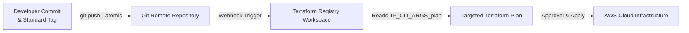

# Terraform Infrastructure as Code (IaC) — Master Deployment Suite

This directory contains the production-grade deployment runbooks and configuration blueprints for the 5 enterprise Terraform infrastructure files (maintained in the parallel infrastructure repository `UAX-TESTING`).

---

## 1. Enterprise CI/CD Deployment Architecture (Terraform Registry)

Deployments are fully automated through the **Terraform Registry** workspace CI/CD integration:



### How the Deployment Pipeline Works
1. **Tag-Driven Automated Execution**: To deploy infrastructure or update scripts, developers push a commit along with an organization standard release tag.
2. **Automated Registry Trigger**: The remote repository webhook detects the release tag push and automatically triggers a new run in the **Terraform Registry** workspace.
3. **Registry Monitoring**: Developers monitor the execution, plan logs, and resource diffs directly in the Terraform Registry UI.
4. **Targeted Execution via `TF_CLI_ARGS_plan`**: By default, Terraform Registry plans against the entire workspace. To target specific modules or services without impacting unrelated resources, configure the environment variable **`TF_CLI_ARGS_plan`** in the Terraform Registry workspace settings.

---

## 2. Targeted Execution Syntax (`TF_CLI_ARGS_plan`)

To limit the plan and apply phases to specific modules, set the **`TF_CLI_ARGS_plan`** variable in the Terraform Registry workspace.

### Target Pattern Syntax
Multiple modules and resources are chained using space-separated `--target` arguments:
```text
--target=module.<modulename1> --target=module.<modulename2> --target=aws_security_group_rule.<rulename>
```

> [!IMPORTANT]
> When `TF_CLI_ARGS_plan` is populated in the Terraform Registry workspace, the automated run initiated by pushing your tag will **only** plan and apply the specified target resources.

---

## 3. Ready-to-Use `TF_CLI_ARGS_plan` Target Variables

Below are pre-composed, production-validated target variable strings ready to copy directly into the **`TF_CLI_ARGS_plan`** field in the Terraform Registry.

### 1. Bronze Layer (All 12 Modules)
Targets the complete Bronze ingestion infrastructure defined in `uax_datalake_bronze.tf`:
```bash
--target=module.uax_datalake_kms_key --target=module.uax_datalake_bronze_s3_bucket --target=module.uax_datalake_bronze_servicenow_secret --target=module.uax_datalake_bronze_moveworks_secret --target=module.uax_datalake_bronze_genesys_secret --target=module.uax_datalake_bronze_glue_iam_policy --target=module.uax_datalake_lambda_iam_role --target=module.uax_datalake_bronze_glue_iam_role --target=module.uax_datalake_glue_catalog_database --target=module.uax_datalake_bronze_glue_job --target=module.uax_datalake_bronze_files --target=module.uax_datalake_bronze_connectors_zip
```

### 2. Silver Layer (All 4 Modules + 1 Security Group Rule)
Targets the complete Silver conformance infrastructure defined in `uax_datalake_silver.tf`:
```bash
--target=module.uax_datalake_silver_gule_sg --target=aws_security_group_rule.uax_datalake_silver_rds_ingress_from_glue --target=module.uax_datalake_glue_connection --target=module.uax_datalake_silver_iceberg_job --target=module.uax_datalake_silver_files
```

### 3. Gold Layer (All 3 Modules)
Targets the complete Gold mart and serving infrastructure defined in `uax_datalake_gold.tf`:
```bash
--target=module.uax_datalake_gold_mart_job --target=module.uax_datalake_gold_rds_db_secret --target=module.uax_datalake_gold_files
```

### 4. Athena Layer (1 Module)
Targets the Athena analytics workgroup infrastructure defined in `uax_datalake_athena.tf`:
```bash
--target=module.uax_datalake_athena_workgroup
```

### 5. Moveworks Pipeline Orchestration (All 10 Modules)
Targets the end-to-end Glue workflow DAG, chained triggers, EventBridge rules, and SNS alerting defined in `uax_datalake_moveworks_pipeline.tf`:
```bash
--target=module.uax_datalake_sns_topic --target=module.uax_datalake_sns_topic_subscription --target=module.uax_datalake_moveworks_workflow --target=module.uax_datalake_moveworks_bronze_trigger --target=module.uax_datalake_moveworks_silver_trigger --target=module.uax_datalake_moveworks_gold_trigger --target=module.uax_datalake_moveworks_workflow_success_rule --target=module.uax_datalake_moveworks_workflow_failure_rule --target=module.uax_datalake_moveworks_workflow_success_target --target=module.uax_datalake_moveworks_workflow_failure_target
```

---

## 4. Multi-Layer S3 Upload Target Variables

Use these pre-composed variables when updating executable scripts, configurations, or connector archives across layers without reprovisioning cloud compute or network resources.

### Combined S3 Script Uploads (Bronze + Silver + Gold Scripts)
Targets only the ETL scripts, transformer modules, and JSON configuration files across all three datalake layers:
```bash
--target=module.uax_datalake_bronze_files --target=module.uax_datalake_silver_files --target=module.uax_datalake_gold_files
```

### Combined All S3 Uploads (Bronze Scripts + Connectors Zip + Silver Scripts + Gold Scripts)
Targets all S3 deployment objects across Bronze, Silver, and Gold, including both the scripts and the third-party JDBC connector archive:
```bash
--target=module.uax_datalake_bronze_files --target=module.uax_datalake_bronze_connectors_zip --target=module.uax_datalake_silver_files --target=module.uax_datalake_gold_files
```

---

## 5. Granular Target Cheat-Sheet (Module & Resource Catalog)

Developers can cherry-pick individual targets from this table to compose customized `TF_CLI_ARGS_plan` values:

| Source File | Line # | Target Identifier | Resource Type / Purpose |
| :--- | :---: | :--- | :--- |
| **`uax_datalake_bronze.tf`** | L71 | `--target=module.uax_datalake_kms_key` | KMS Customer Managed Key |
| | L99 | `--target=module.uax_datalake_bronze_s3_bucket` | Bronze Landing S3 Bucket |
| | L130 | `--target=module.uax_datalake_bronze_servicenow_secret` | ServiceNow Secrets Vault |
| | L169 | `--target=module.uax_datalake_bronze_moveworks_secret` | Moveworks OAuth2 Secrets Vault |
| | L205 | `--target=module.uax_datalake_bronze_genesys_secret` | Genesys CX Secrets Vault |
| | L247 | `--target=module.uax_datalake_bronze_glue_iam_policy` | Glue IAM Least-Privilege Policy |
| | L393 | `--target=module.uax_datalake_lambda_iam_role` | Lambda Support Role |
| | L428 | `--target=module.uax_datalake_bronze_glue_iam_role` | Glue Bronze Service Role |
| | L466 | `--target=module.uax_datalake_glue_catalog_database` | Glue Data Catalog Database |
| | L480 | `--target=module.uax_datalake_bronze_glue_job` | Bronze Ingestion Glue Job |
| | L598 | `--target=module.uax_datalake_bronze_files` | Bronze S3 Python/JSON Scripts |
| | L637 | `--target=module.uax_datalake_bronze_connectors_zip` | Bronze S3 JDBC Connectors Zip |
| **`uax_datalake_silver.tf`** | L28 | `--target=module.uax_datalake_silver_gule_sg` | Glue VPC Security Group |
| | L141 | `--target=aws_security_group_rule.uax_datalake_silver_rds_ingress_from_glue` | RDS Aurora Ingress Firewall Rule |
| | L158 | `--target=module.uax_datalake_glue_connection` | Glue VPC Network Connection |
| | L180 | `--target=module.uax_datalake_silver_iceberg_job` | Silver Iceberg ETL Glue Job |
| | L254 | `--target=module.uax_datalake_silver_files` | Silver S3 PySpark/Iceberg Scripts |
| **`uax_datalake_gold.tf`** | L29 | `--target=module.uax_datalake_gold_mart_job` | Gold Mart ETL Engine Glue Job |
| | L107 | `--target=module.uax_datalake_gold_rds_db_secret` | Aurora MySQL Database Secret |
| | L145 | `--target=module.uax_datalake_gold_files` | Gold S3 PySpark/SQL Scripts |
| **`uax_datalake_athena.tf`** | L28 | `--target=module.uax_datalake_athena_workgroup` | Dedicated Athena Workgroup |
| **`uax_datalake_moveworks_pipeline.tf`** | L7 | `--target=module.uax_datalake_sns_topic` | Central Pipeline SNS Topic |
| | L34 | `--target=module.uax_datalake_sns_topic_subscription` | SNS Topic Subscriptions |
| | L45 | `--target=module.uax_datalake_moveworks_workflow` | Master Glue Workflow DAG |
| | L74 | `--target=module.uax_datalake_moveworks_bronze_trigger` | Bronze Start/Schedule Trigger |
| | L127 | `--target=module.uax_datalake_moveworks_silver_trigger` | Silver Conditional Trigger |
| | L184 | `--target=module.uax_datalake_moveworks_gold_trigger` | Gold Conditional Trigger |
| | L245 | `--target=module.uax_datalake_moveworks_workflow_success_rule` | EventBridge Success Rule |
| | L291 | `--target=module.uax_datalake_moveworks_workflow_failure_rule` | EventBridge Failure Rule |
| | L337 | `--target=module.uax_datalake_moveworks_workflow_success_target` | EventBridge Success Target (SNS) |
| | L349 | `--target=module.uax_datalake_moveworks_workflow_failure_target` | EventBridge Failure Target (SNS) |

---

## 6. Standard Developer Workflow (Git Bash in VS Code)

All development, formatting, syntax validation, and release triggering are performed in **Git Bash** via the integrated terminal in VS Code (<kbd>Ctrl</kbd> + <kbd>`</kbd>):

### Step 1: Validate Environment & Plugins
```bash
# Verify Terraform version
terraform -version

# Initialize and reconfigure state backend
terraform init -reconfigure

# Format HCL code
terraform fmt <filename.tf>

# Validate syntax
terraform validate
```

### Step 2: Local Targeted Plan Verification
Before pushing changes, simulate the plan locally:
```bash
terraform plan -target=module.<module_name>
```

### Step 3: Commit and Trigger Terraform Registry
```bash
# 1. Stage modified files
git add <filename.tf>

# 2. Semantic commit
git commit -m "feat(<scope>): deploy <module_name>"

# 3. Create release tag using standard format
git tag <tagname>

# 4. Push commit and tag atomically
git push --atomic origin <branch> <tagname>
```

### Step 4: Verify Execution in Terraform Registry
1. Open the **Terraform Registry** workspace UI.
2. Confirm the `TF_CLI_ARGS_plan` variable is set to the desired `--target` pattern.
3. Observe the automatically triggered run, review the planned changes, and approve the deployment.

---

## 7. Deep-Dive Runbook Index

For comprehensive line-by-line catalogs, dependency flowcharts, and individual execution instructions, consult the individual layer runbooks:

* [**UAX_DATALAKE_BRONZE.md**](UAX_DATALAKE_BRONZE.md) — 12 Modules (KMS, S3 Bucket, Secrets, IAM, Glue Job, S3 Files, Connectors Zip).
* [**UAX_DATALAKE_SILVER.md**](UAX_DATALAKE_SILVER.md) — 4 Modules + 1 Resource (Glue SG, Aurora Ingress Rule, Glue Connection, Iceberg Job, S3 Files).
* [**UAX_DATALAKE_GOLD.md**](UAX_DATALAKE_GOLD.md) — 3 Modules (Gold Mart Job, Aurora Secret, S3 Files).
* [**UAX_DATALAKE_ATHENA.md**](UAX_DATALAKE_ATHENA.md) — 1 Module (Athena Workgroup).
* [**UAX_DATALAKE_MOVEWORKS_PIPELINE.md**](UAX_DATALAKE_MOVEWORKS_PIPELINE.md) — 10 Modules (SNS Topic/Sub, Glue Workflow, 3 Triggers, EventBridge Rules/Targets).
