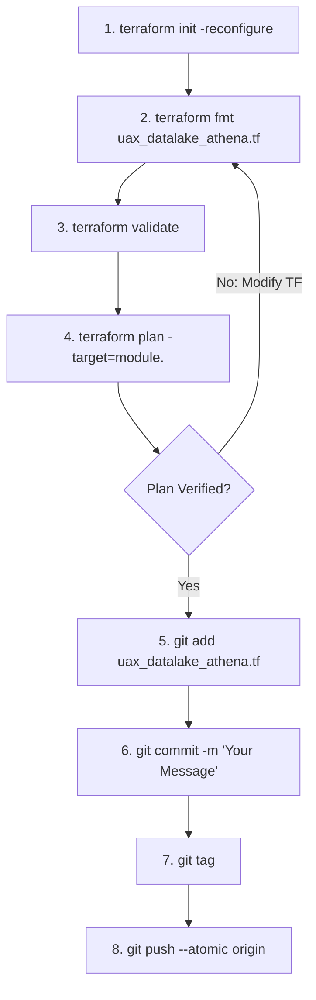

# Terraform Deployment Runbook — Athena Engine (`uax_datalake_athena.tf`)

## 1. Executive Summary & Purpose

This document serves as the production-grade deployment runbook for the **Amazon Athena Query Engine Infrastructure as Code (IaC)** defined in `uax_datalake_athena.tf`.

The configuration resides within the enterprise infrastructure repository (maintained in parallel to the `Data-pipeline` repository) and provisions the isolated serverless SQL query environment for the data lakehouse:
* **Dedicated Athena Workgroup**: Provisions `uax_datalake_athena_workgroup` (e.g. `uax-datalake-workgroup-{env}`) enforcing client query execution isolation, query cancellation controls, and performance governance.
* **Encrypted Query Results**: Enforces mandatory server-side encryption using Customer Managed KMS Keys (SSE-KMS) for all Athena query result output sets in S3.
* **Cost & Performance Controls**: Enforces centralized result output directory routing, per-query data scan limits, and CloudWatch execution metrics publishing for BI queries (Tableau, Power BI, ad-hoc data analysis).

---

## 2. Developer Environment & Terminal Setup

All Terraform modifications and deployments must be executed through **Git Bash** on a properly authenticated terminal session. Follow this standard pre-flight setup:

### Step 1: Clone Repository & Switch Branch
```bash
# Clone the infrastructure repository
git clone <repository_url>

# Navigate into the cloned project root
cd <repository_folder>

# Fetch latest remote refs and switch to your feature/deployment branch
git fetch origin
git checkout <branch_name>
git pull origin <branch_name>
```

### Step 2: Open Project in VS Code
From the cloned repository directory:
```bash
# Launch VS Code in the current directory
code .
```

### Step 3: Launch Integrated Git Bash Terminal
1. Inside VS Code, press <kbd>Ctrl</kbd> + <kbd>`</kbd> (or go to **Terminal** $\to$ **New Terminal**).
2. Click the dropdown arrow next to the `+` icon on the terminal tab and select **Git Bash**.
3. Verify your Terraform CLI installation and version:
   ```bash
   terraform -version
   ```

---

## 3. Production Deployment SOP (Standard Operating Procedure)

For every infrastructure change to `uax_datalake_athena.tf`, adhere strictly to the following 8-step lifecycle. **Do not run global applies without targeted plan verification.**



### Step 1: Reconfigure Terraform Backend
Synchronizes state backend, S3 remote state lock DynamoDB table, and provider plugins:
```bash
terraform init -reconfigure
```

### Step 2: Format Terraform Code
Enforces canonical HCL formatting and indentation:
```bash
terraform fmt uax_datalake_athena.tf
```

### Step 3: Validate Configuration Syntax
Verifies syntactic validity, internal consistency, and schema correctness:
```bash
terraform validate
```

### Step 4: Targeted Plan Verification
Target only the specific module being deployed or updated:
```bash
terraform plan -target=module.uax_datalake_athena_workgroup
```
> [!IMPORTANT]
> Verify that existing workgroup configurations, output bucket pointers, and KMS encryption configurations are updated in-place (`~ update in-place`) and not flagged for replacement (`-/+`).

### Step 5: Stage Modified File
```bash
git add uax_datalake_athena.tf
```

### Step 6: Semantic Git Commit
Commit using standard semantic commit messages:
```bash
git commit -m "feat(athena): configure uax_datalake_athena_workgroup query engine"
```

### Step 7: Create Deployment Release Tag
Tag the commit using your standard tag name format to trigger execution in the Terraform Registry:
```bash
git tag <tagname>
```

### Step 8: Atomic Push (Branch + Tag)
Pushes both the commit and the release tag in a single atomic transaction:
```bash
git push --atomic origin <branch> <tagname>
```

---

## 4. Module Inventory & Component Catalog (`uax_datalake_athena.tf`)

`uax_datalake_athena.tf` encapsulates **1 modular building block** at line 28:

| Line # | Module Identifier | AWS Resource / Service | Primary Architectural Purpose |
| :---: | :--- | :--- | :--- |
| **L28** | `module "uax_datalake_athena_workgroup"` | Amazon Athena Workgroup (`aws_athena_workgroup`) | Dedicated analytics query workgroup enforcing client-side query execution isolation, query results encryption with KMS, S3 output prefix routing, and CloudWatch metrics publishing. |

---

## 5. Deployment & Execution Guide

### Targeted Plan & Deployment Command
```bash
terraform plan -target=module.uax_datalake_athena_workgroup
```

### External Dependencies
`module.uax_datalake_athena_workgroup` depends on:
* **Root KMS Key** (`module.uax_datalake_kms_key` in `uax_datalake_bronze.tf`): Used for SSE-KMS encryption of Athena query results.
* **Target S3 Bucket**: S3 bucket prefix designated for Athena query result dumps (e.g. `s3://<bucket>/athena-results/`).

---

## 6. Production Safety Rules & Engineering Standards

1. **Targeted Plans in Shared Workspaces**:
   - Always run targeted plans using `-target=module.uax_datalake_athena_workgroup` to avoid unintended modifications to surrounding data pipeline modules.
2. **Workgroup Configuration Enforcement**:
   - Ensure `enforce_workgroup_configuration = true` so that all analyst queries and BI dashboard connectors adhere to KMS encryption and result location mandates, preventing unencrypted data spills.
3. **Atomic Git Push (`--atomic`)**:
   - Standard `git push` followed by separate tag pushes can cause race conditions in release webhooks. Always execute `git push --atomic origin <branch> <tagname>`.
4. **Tagging Convention**:
   - Always format release tags using your organization's standard tag name format. Pushing the tag with your commit triggers automated pipeline execution in the Terraform Registry.
