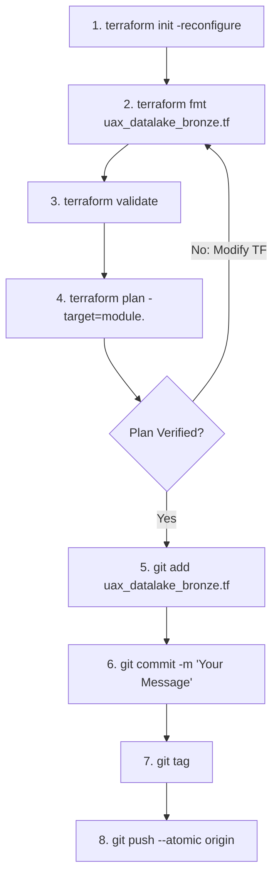
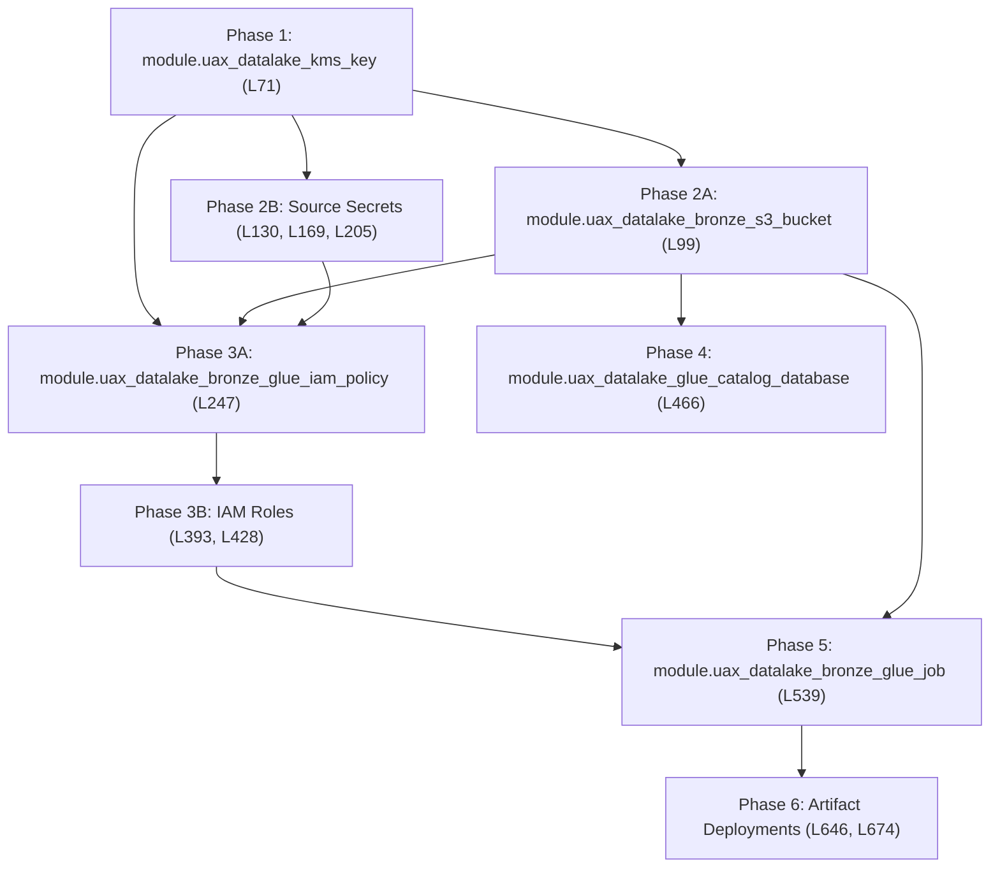

# Terraform Deployment Runbook — Bronze Layer (`uax_datalake_bronze.tf`)

## 1. Executive Summary & Purpose

This document serves as the production-grade deployment runbook for the **Bronze Layer Infrastructure as Code (IaC)** defined in `uax_datalake_bronze.tf`.

The configuration resides within the enterprise infrastructure repository (maintained in parallel to the `Data-pipeline` repository) and provisions the complete AWS foundation required for Bronze raw data ingestion:
* **Enterprise Security & Encryption**: Customer Managed KMS Key (CMK) for encryption at rest across all data, secrets, and logs.
* **Data Lake Storage**: S3 Bronze bucket with strict public access blocks, SSE-KMS encryption, versioning, and lifecycle management.
* **Secrets Orchestration**: AWS Secrets Manager credentials for external source APIs (ServiceNow, Moveworks, Genesys Cloud CX).
* **IAM Least-Privilege Governance**: Granular IAM policy and dedicated service roles for AWS Glue ETL and supporting Lambda functions.
* **Glue Data Catalog**: Metadata database registering raw ingested table schemas and partition metadata.
* **Glue Processing Engine**: AWS Glue PySpark/Python ETL job definition (`uax_bronze_load`).
* **Deployment Artifacts**: Automated S3 deployment of ingestion scripts, table configurations, and connector dependencies.

---

## 2. Developer Environment & Terminal Setup

All Terraform modifications and deployments must be executed through **Git Bash** on a properly authenticated terminal session. Follow this standard pre-flight setup:

### Step 1: Clone Repository & Switch Branch
```bash
# Clone the infrastructure repository
git clone <repository_url>

# Navigate into the cloned project root
cd <repository_folder>

# Fetch latest remote refs and switch to your feature/deployment branch
git fetch origin
git checkout <branch_name>
git pull origin <branch_name>
```

### Step 2: Open Project in VS Code
From the cloned repository directory:
```bash
# Launch VS Code in the current directory
code .
```

### Step 3: Launch Integrated Git Bash Terminal
1. Inside VS Code, press <kbd>Ctrl</kbd> + <kbd>`</kbd> (or go to **Terminal** $\to$ **New Terminal**).
2. Click the dropdown arrow next to the `+` icon on the terminal tab and select **Git Bash**.
3. Verify your Terraform CLI installation and version:
   ```bash
   terraform -version
   ```

---

## 3. Production Deployment SOP (Standard Operating Procedure)

For every infrastructure change to `uax_datalake_bronze.tf`, adhere strictly to the following 8-step lifecycle. **Do not run global applies without targeted plan verification.**



### Step 1: Reconfigure Terraform Backend
Ensures the state backend, remote S3 state lock DynamoDB table, and provider plugins are synchronized with your target workspace:
```bash
terraform init -reconfigure
```

### Step 2: Format Terraform Code
Enforces canonical HCL formatting and indentation:
```bash
terraform fmt uax_datalake_bronze.tf
```

### Step 3: Validate Configuration Syntax
Verifies syntactic validity, internal consistency, and schema correctness without contacting remote cloud APIs:
```bash
terraform validate
```

### Step 4: Targeted Plan Verification
Target only the specific module being deployed or updated to avoid unintended drift modifications across unrelated services:
```bash
terraform plan -target=module.<module_name>
```
> [!IMPORTANT]
> Carefully review the resource diff (`+ create`, `~ update in-place`, `- destroy`). Ensure no critical stateful resources (such as S3 buckets or KMS keys) are flagged for replacement (`-/+`).

### Step 5: Stage Modified File
```bash
git add uax_datalake_bronze.tf
```

### Step 6: Semantic Git Commit
Commit using standard semantic commit messages:
```bash
git commit -m "feat(bronze): deploy <module_name> for bronze layer ingestion"
```

### Step 7: Create Deployment Release Tag
Tag the commit using your standard tag name format to trigger execution in the Terraform Registry:
```bash
git tag <tagname>
```

### Step 8: Atomic Push (Branch + Tag)
Pushes both the commit and the release tag in a single atomic transaction, preventing dangling tags or partial CI/CD triggers:
```bash
git push --atomic origin <branch> <tagname>
```

---

## 4. Module Inventory & Component Catalog (`uax_datalake_bronze.tf`)

`uax_datalake_bronze.tf` encapsulates **12 modular building blocks** structured across lines 71 to 674. Below is the master module catalog:

| Line # | Module Identifier | AWS Resource / Service | Primary Architectural Purpose |
| :---: | :--- | :--- | :--- |
| **L71** | `module "uax_datalake_kms_key"` | AWS KMS CMK (`aws_kms_key`, `aws_kms_alias`) | Root Customer Managed Key for envelope encryption across Bronze S3, Secrets Manager, Glue, and CloudWatch. |
| **L99** | `module "uax_datalake_bronze_s3_bucket"` | Amazon S3 (`aws_s3_bucket`, policies, encryption) | Bronze landing data lake bucket (`uax-datalake-bronze-{env}-{account_id}`) storing raw ingested payloads. |
| **L130** | `module "uax_datalake_bronze_servicenow_secret"` | AWS Secrets Manager (`aws_secretsmanager_secret`) | Secure vault for ServiceNow REST API credentials (base URL, user/pass, token parameters). |
| **L169** | `module "uax_datalake_bronze_moveworks_secret"` | AWS Secrets Manager (`aws_secretsmanager_secret`) | Secure vault for Moveworks OAuth2 Client Credentials (`client_id`, `client_secret`, `token_url`). |
| **L205** | `module "uax_datalake_bronze_genesys_secret"` | AWS Secrets Manager (`aws_secretsmanager_secret`) | Secure vault for Genesys Cloud CX OAuth2 Client Credentials (`client_id`, `client_secret`, auth endpoint). |
| **L247** | `module "uax_datalake_bronze_glue_iam_policy"` | AWS IAM (`aws_iam_policy`) | Customer managed policy enforcing least-privilege access to S3, Secrets Manager, KMS, and CloudWatch Logs. |
| **L393** | `module "uax_datalake_lambda_iam_role"` | AWS IAM (`aws_iam_role`) | Service role for supporting Lambda helper functions (Protegrity PII tokenization, pipeline webhooks). |
| **L428** | `module "uax_datalake_bronze_glue_iam_role"` | AWS IAM (`aws_iam_role`, attachments) | Service role assumed by AWS Glue (`glue.amazonaws.com`) to execute Bronze ETL ingestion jobs. |
| **L466** | `module "uax_datalake_glue_catalog_database"` | AWS Glue Data Catalog (`aws_glue_catalog_database`) | Metadata database registering raw ingested table schemas and partition metadata. |
| **L539** | `module "uax_datalake_bronze_glue_job"` | AWS Glue Job (`aws_glue_job`) | Main PySpark/Python Shell batch ingestion job running `uax_bronze_load.py` with allocated DPUs. |
| **L646** | `module "uax_datalake_bronze_files"` | Amazon S3 Objects (`aws_s3_object`) | Deploys runtime script files (`uax_bronze_load.py`, `config_loader.py`, `bronze_config.json`) to the scripts S3 prefix. |
| **L674** | `module "uax_datalake_bronze_connectors_zip"` | Amazon S3 Object (`aws_s3_object`) | Packages and deploys connector libraries (`connectors.zip`) to `--extra-py-files` S3 location. |

---

## 5. Phased Deployment & Dependency Order

When deploying infrastructure from scratch or applying significant updates, execute modules in their strict **dependency sequence** using the targeted plan commands below:



### Phase 1 — Security Foundation (KMS Key)
Provisions the root encryption key required by all downstream storage and compute services:
```bash
terraform plan -target=module.uax_datalake_kms_key
```

### Phase 2 — Storage & Source Secrets
Provisions the data lake bucket and Secrets Manager vaults:
```bash
# 2A: S3 Landing Bucket
terraform plan -target=module.uax_datalake_bronze_s3_bucket

# 2B: Source System Secrets
terraform plan -target=module.uax_datalake_bronze_servicenow_secret
terraform plan -target=module.uax_datalake_bronze_moveworks_secret
terraform plan -target=module.uax_datalake_bronze_genesys_secret
```

### Phase 3 — Identity & Access Management (IAM)
Provisions the least-privilege policy and service execution roles:
```bash
# 3A: Glue IAM Policy (depends on KMS, S3, Secrets)
terraform plan -target=module.uax_datalake_bronze_glue_iam_policy

# 3B: Lambda & Glue IAM Roles
terraform plan -target=module.uax_datalake_lambda_iam_role
terraform plan -target=module.uax_datalake_bronze_glue_iam_role
```

### Phase 4 — Data Catalog Database
Provisions the metadata repository registering raw ingested table schemas:
```bash
terraform plan -target=module.uax_datalake_glue_catalog_database
```

### Phase 5 — ETL Compute Engine (Glue Job)
Provisions the AWS Glue job definition with worker allocations, script parameters, and execution triggers:
```bash
terraform plan -target=module.uax_datalake_bronze_glue_job
```

### Phase 6 — Deployment Artifacts (Scripts & Connectors)
Uploads the executable Python scripts and modular connector packages to S3:
```bash
# 6A: Python Scripts & JSON Configs
terraform plan -target=module.uax_datalake_bronze_files

# 6B: Packaged Connector Zip (.whl / .zip)
terraform plan -target=module.uax_datalake_bronze_connectors_zip
```

---

## 6. Production Safety Rules & Engineering Standards

1. **Always Use Targeted Plans in Shared Workspaces**:
   - Running an un-targeted `terraform plan` across a multi-component environment can detect state drift on un-related services and trigger accidental recreations. Always isolate via `-target=module.<name>`.
2. **Never Commit Plaintext Secrets**:
   - Secrets Manager secret values must be populated via AWS CLI, AWS Console, or external parameter store post-provisioning. Never check passwords, tokens, or client secrets into `.tf` files.
3. **Atomic Git Push (`--atomic`)**:
   - Standard `git push` followed by `git push --tags` is non-atomic. If the tag push fails due to a network glitch, CI/CD automated release webhooks may fail to trigger. `--atomic` guarantees all-or-nothing execution.
4. **Tagging Convention**:
   - Always format release tags using your organization's standard tag name format. Pushing the tag with your commit triggers automated pipeline execution in the Terraform Registry.
