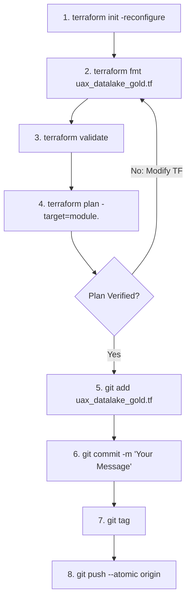
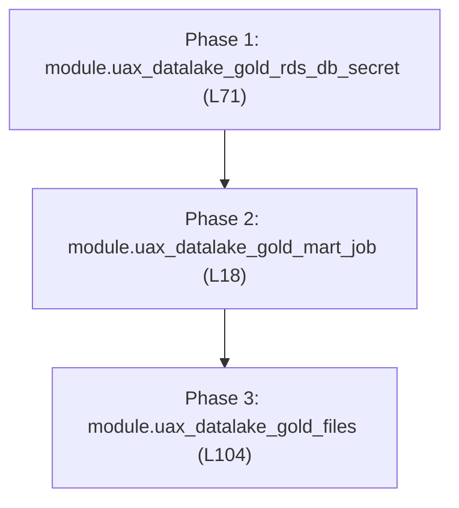

# Terraform Deployment Runbook — Gold Layer (`uax_datalake_gold.tf`)

## 1. Executive Summary & Purpose

This document serves as the production-grade deployment runbook for the **Gold Layer Infrastructure as Code (IaC)** defined in `uax_datalake_gold.tf`.

The configuration resides within the enterprise infrastructure repository (maintained in parallel to the `Data-pipeline` repository) and provisions the complete AWS foundation required for dimensional business data marts and multi-engine serving:
* **Gold Mart PySpark ETL Engine**: Dedicated AWS Glue Job (`uax_datalake_gold_mart_job`) running `gold_layer_manager.py`, responsible for executing cross-layer business SQL queries, standardizing timestamps, materializing authoritative Apache Iceberg marts in the Glue Data Catalog, and performing zero-downtime atomic staging swaps to Amazon Aurora MySQL.
* **Serving Database Secrets**: AWS Secrets Manager vault (`uax_datalake_gold_rds_db_secret`) storing Aurora MySQL credentials (`username`, `password`, `host`, `port`, `database_name`) dynamically resolved at runtime by the Gold engine.
* **Deployment Artifacts**: Automated S3 deployment (`uax_datalake_gold_files`) synchronizing Gold engine scripts, historical bootstrap utilities, custom transforms, business SQL queries (`gold/query/*`), and `gold_config.json`.

---

## 2. Developer Environment & Terminal Setup

All Terraform modifications and deployments must be executed through **Git Bash** on a properly authenticated terminal session. Follow this standard pre-flight setup:

### Step 1: Clone Repository & Switch Branch
```bash
# Clone the infrastructure repository
git clone <repository_url>

# Navigate into the cloned project root
cd <repository_folder>

# Fetch latest remote refs and switch to your feature/deployment branch
git fetch origin
git checkout <branch_name>
git pull origin <branch_name>
```

### Step 2: Open Project in VS Code
From the cloned repository directory:
```bash
# Launch VS Code in the current directory
code .
```

### Step 3: Launch Integrated Git Bash Terminal
1. Inside VS Code, press <kbd>Ctrl</kbd> + <kbd>`</kbd> (or go to **Terminal** $\to$ **New Terminal**).
2. Click the dropdown arrow next to the `+` icon on the terminal tab and select **Git Bash**.
3. Verify your Terraform CLI installation and version:
   ```bash
   terraform -version
   ```

---

## 3. Production Deployment SOP (Standard Operating Procedure)

For every infrastructure change to `uax_datalake_gold.tf`, adhere strictly to the following 8-step lifecycle. **Do not run global applies without targeted plan verification.**



### Step 1: Reconfigure Terraform Backend
Synchronizes the state backend, S3 remote state lock DynamoDB table, and provider plugins:
```bash
terraform init -reconfigure
```

### Step 2: Format Terraform Code
Enforces canonical HCL formatting and indentation:
```bash
terraform fmt uax_datalake_gold.tf
```

### Step 3: Validate Configuration Syntax
Verifies syntactic validity, internal consistency, and schema correctness:
```bash
terraform validate
```

### Step 4: Targeted Plan Verification
Target only the specific module being deployed or updated to avoid unintended drift across unrelated infrastructure:
```bash
terraform plan -target=module.<module_name>
```
> [!IMPORTANT]
> Carefully review the resource diff (`+ create`, `~ update in-place`, `- destroy`). Ensure secrets or Glue jobs are not flagged for unexpected replacement.

### Step 5: Stage Modified File
```bash
git add uax_datalake_gold.tf
```

### Step 6: Semantic Git Commit
Commit using standard semantic commit messages:
```bash
git commit -m "feat(gold): deploy <module_name> for gold layer serving"
```

### Step 7: Create Deployment Release Tag
Tag the commit using your standard tag name format to trigger execution in the Terraform Registry:
```bash
git tag <tagname>
```

### Step 8: Atomic Push (Branch + Tag)
Pushes both the commit and the release tag in a single atomic transaction:
```bash
git push --atomic origin <branch> <tagname>
```

---

## 4. Module Inventory & Component Catalog (`uax_datalake_gold.tf`)

`uax_datalake_gold.tf` encapsulates **3 modular building blocks** across lines 18 to 104. Below is the master module catalog:

| Line # | Module Identifier | AWS Resource / Service | Primary Architectural Purpose |
| :---: | :--- | :--- | :--- |
| **L18** | `module "uax_datalake_gold_mart_job"` | AWS Glue Job (`aws_glue_job`) | Main PySpark batch job running `gold_layer_manager.py` with Apache Iceberg extensions, G.1X/G.2X workers, JDBC VPC connectivity, and serving swap logic. |
| **L71** | `module "uax_datalake_gold_rds_db_secret"` | AWS Secrets Manager (`aws_secretsmanager_secret`) | Secure vault storing Amazon Aurora MySQL credentials (`username`, `password`, `host`, `port`) for downstream operational dashboard serving. |
| **L104** | `module "uax_datalake_gold_files"` | Amazon S3 Objects (`aws_s3_object`) | Deploys runtime Python scripts (`gold_layer_manager.py`, `gold_config_loader.py`), custom transforms, SQL queries (`gold/query/*`), and `gold_config.json`. |

---

## 5. Phased Deployment & Dependency Order

Execute modules in their strict **dependency sequence** using the targeted plan commands below:



### Phase 1 — Serving Database Secrets
Provisions the Secrets Manager vault for downstream Aurora MySQL credentials:
```bash
terraform plan -target=module.uax_datalake_gold_rds_db_secret
```

### Phase 2 — Gold Mart Compute Engine (Glue Job)
Provisions the AWS Glue job definition with allocated DPUs, Iceberg Spark runtime configurations, JDBC VPC connection parameters, and timeout settings:
```bash
terraform plan -target=module.uax_datalake_gold_mart_job
```

### Phase 3 — Gold Code & Query Artifact Deployments
Uploads the executable PySpark scripts, modular SQL queries (`gold/query/<source>/*.sql`), and `gold_config.json` to S3:
```bash
terraform plan -target=module.uax_datalake_gold_files
```

---

## 6. Production Safety Rules & Engineering Standards

1. **Targeted Plans in Shared Workspaces**:
   - Always isolate deployments via `-target=module.<name>` to prevent unexpected changes to database secrets or compute definitions during partial updates.
2. **Aurora Secret Protection**:
   - The secret vault (`module.uax_datalake_gold_rds_db_secret`) must never store hardcoded plaintext credentials in Terraform source code. Passwords must be set via AWS Secrets Manager or secure CLI post-creation.
3. **Atomic Git Push (`--atomic`)**:
   - Standard `git push` followed by separate tag pushes can cause race conditions in CI/CD release webhooks. Always push atomically via `git push --atomic origin <branch> <tagname>`.
4. **Tagging Convention**:
   - Always format release tags using your organization's standard tag name format. Pushing the tag with your commit triggers automated pipeline execution in the Terraform Registry.
