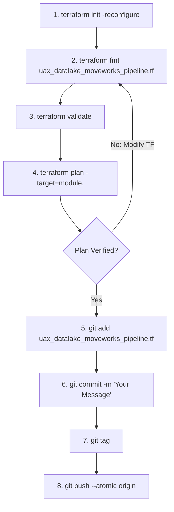
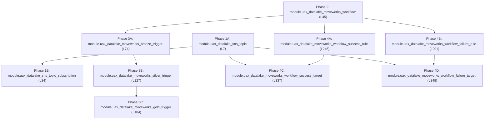

# Terraform Deployment Runbook — Moveworks Pipeline (`uax_datalake_moveworks_pipeline.tf`)

## 1. Executive Summary & Purpose

This document serves as the production-grade deployment runbook for the **Moveworks End-to-End Orchestration & Monitoring Pipeline Infrastructure as Code (IaC)** defined in `uax_datalake_moveworks_pipeline.tf`.

The configuration resides within the enterprise infrastructure repository (maintained in parallel to the `Data-pipeline` repository) and provisions the end-to-end automated pipeline orchestration, sequential stage transitions, and telemetry alerting:
* **Enterprise Alerting Foundation**: Dedicated Amazon SNS Topic (`uax_datalake_sns_topic`) and subscriptions delivering automated execution notifications and operational alerts to data engineering teams.
* **Glue Workflow Orchestrator**: AWS Glue Workflow (`uax_datalake_moveworks_workflow`) coordinating the full Medallion lifecycle (`Bronze` $\to$ `Silver` $\to$ `Gold`).
* **Sequential Stage Triggers**: Three chained AWS Glue Triggers (`bronze_trigger`, `silver_trigger`, `gold_trigger`) enforcing deterministic dependency execution and conditional handoffs.
* **EventBridge Observability & Alert Routing**: CloudWatch EventBridge rules and targets detecting workflow success and failure events, automatically routing structured diagnostic alerts to the SNS topic.

---

## 2. Developer Environment & Terminal Setup

All Terraform modifications and deployments must be executed through **Git Bash** on a properly authenticated terminal session. Follow this standard pre-flight setup:

### Step 1: Clone Repository & Switch Branch
```bash
# Clone the infrastructure repository
git clone <repository_url>

# Navigate into the cloned project root
cd <repository_folder>

# Fetch latest remote refs and switch to your feature/deployment branch
git fetch origin
git checkout <branch_name>
git pull origin <branch_name>
```

### Step 2: Open Project in VS Code
From the cloned repository directory:
```bash
# Launch VS Code in the current directory
code .
```

### Step 3: Launch Integrated Git Bash Terminal
1. Inside VS Code, press <kbd>Ctrl</kbd> + <kbd>`</kbd> (or go to **Terminal** $\to$ **New Terminal**).
2. Click the dropdown arrow next to the `+` icon on the terminal tab and select **Git Bash**.
3. Verify your Terraform CLI installation and version:
   ```bash
   terraform -version
   ```

---

## 3. Production Deployment SOP (Standard Operating Procedure)

For every infrastructure change to `uax_datalake_moveworks_pipeline.tf`, adhere strictly to the following 8-step lifecycle. **Do not run global applies without targeted plan verification.**



### Step 1: Reconfigure Terraform Backend
Synchronizes state backend, S3 remote state lock DynamoDB table, and provider plugins:
```bash
terraform init -reconfigure
```

### Step 2: Format Terraform Code
Enforces canonical HCL formatting and indentation:
```bash
terraform fmt uax_datalake_moveworks_pipeline.tf
```

### Step 3: Validate Configuration Syntax
Verifies syntactic validity, internal consistency, and schema correctness:
```bash
terraform validate
```

### Step 4: Targeted Plan Verification
Target only the specific module being deployed or updated:
```bash
terraform plan -target=module.<module_name>
```
> [!IMPORTANT]
> Verify that existing triggers, workflows, and EventBridge rules are updated in-place (`~ update in-place`) and not flagged for replacement (`-/+`), which could disrupt active scheduled pipelines.

### Step 5: Stage Modified File
```bash
git add uax_datalake_moveworks_pipeline.tf
```

### Step 6: Semantic Git Commit
Commit using standard semantic commit messages:
```bash
git commit -m "feat(orchestration): deploy <module_name> for moveworks pipeline"
```

### Step 7: Create Deployment Release Tag
Tag the commit using your standard tag name format to trigger execution in the Terraform Registry:
```bash
git tag <tagname>
```

### Step 8: Atomic Push (Branch + Tag)
Pushes both the commit and the release tag in a single atomic transaction:
```bash
git push --atomic origin <branch> <tagname>
```

---

## 4. Module Inventory & Component Catalog (`uax_datalake_moveworks_pipeline.tf`)

`uax_datalake_moveworks_pipeline.tf` encapsulates **10 modular building blocks** across lines 7 to 349. Below is the master module catalog:

| Line # | Module Identifier | AWS Resource / Service | Primary Architectural Purpose |
| :---: | :--- | :--- | :--- |
| **L7** | `module "uax_datalake_sns_topic"` | Amazon SNS Topic (`aws_sns_topic`) | Central alerting topic dispatching pipeline success metrics and job failure notifications. |
| **L34** | `module "uax_datalake_sns_topic_subscription"` | Amazon SNS Subscription (`aws_sns_topic_subscription`) | Subscribes email addresses, HTTPS webhooks, or PagerDuty/Slack channels to the pipeline SNS topic. |
| **L45** | `module "uax_datalake_moveworks_workflow"` | AWS Glue Workflow (`aws_glue_workflow`) | Primary workflow graph binding together Bronze, Silver, and Gold execution nodes into a coherent DAG. |
| **L74** | `module "uax_datalake_moveworks_bronze_trigger"` | AWS Glue Trigger (`aws_glue_trigger`) | Workflow starting trigger (schedule or on-demand) initiating the Bronze Ingestion job (`uax_bronze_load`). |
| **L127** | `module "uax_datalake_moveworks_silver_trigger"` | AWS Glue Trigger (`aws_glue_trigger`) | Conditional trigger firing Silver ETL (`uax_silver_etl`) upon successful completion of Bronze ingestion. |
| **L184** | `module "uax_datalake_moveworks_gold_trigger"` | AWS Glue Trigger (`aws_glue_trigger`) | Conditional trigger firing Gold Mart & Serving (`gold_layer_manager`) upon successful completion of Silver ETL. |
| **L245** | `module "uax_datalake_moveworks_workflow_success_rule"` | Amazon EventBridge Rule (`aws_cloudwatch_event_rule`) | Event rule detecting successful workflow completion state across all pipeline nodes. |
| **L291** | `module "uax_datalake_moveworks_workflow_failure_rule"` | Amazon EventBridge Rule (`aws_cloudwatch_event_rule`) | Event rule capturing any job failure, error timeout, or stopped run within the workflow. |
| **L337** | `module "uax_datalake_moveworks_workflow_success_target"` | Amazon EventBridge Target (`aws_cloudwatch_event_target`) | Routes workflow success events directly to the pipeline SNS topic for automated reporting. |
| **L349** | `module "uax_datalake_moveworks_workflow_failure_target"` | Amazon EventBridge Target (`aws_cloudwatch_event_target`) | Routes workflow failure events directly to the pipeline SNS topic with error context for incident triage. |

---

## 5. Phased Deployment & Dependency Order

Execute modules in their strict **dependency sequence** using the targeted plan commands below:



### Phase 1 — Alerting Infrastructure (SNS Topic & Subscription)
Provisions the notification topic and endpoint subscriptions:
```bash
# 1A: SNS Alerting Topic
terraform plan -target=module.uax_datalake_sns_topic

# 1B: Topic Subscriptions (Email/Webhook)
terraform plan -target=module.uax_datalake_sns_topic_subscription
```

### Phase 2 — Workflow Orchestrator
Provisions the master AWS Glue Workflow DAG:
```bash
terraform plan -target=module.uax_datalake_moveworks_workflow
```

### Phase 3 — Sequential Glue Triggers (Bronze $\to$ Silver $\to$ Gold)
Provisions the chained triggers defining conditional job flow:
```bash
# 3A: Bronze Ingestion Trigger
terraform plan -target=module.uax_datalake_moveworks_bronze_trigger

# 3B: Silver Conformance Trigger
terraform plan -target=module.uax_datalake_moveworks_silver_trigger

# 3C: Gold Mart Serving Trigger
terraform plan -target=module.uax_datalake_moveworks_gold_trigger
```

### Phase 4 — EventBridge Observability (Rules & Targets)
Provisions event detection and automated alert routing to SNS:
```bash
# 4A: Success Event Rule & Target
terraform plan -target=module.uax_datalake_moveworks_workflow_success_rule
terraform plan -target=module.uax_datalake_moveworks_workflow_success_target

# 4B: Failure Event Rule & Target
terraform plan -target=module.uax_datalake_moveworks_workflow_failure_rule
terraform plan -target=module.uax_datalake_moveworks_workflow_failure_target
```

---

## 6. Production Safety Rules & Engineering Standards

1. **Targeted Plans Prevent Workflow State Desynchronization**:
   - Always run targeted plans using `-target=module.<name>`. Un-targeted plans in multi-workflow environments can accidentally reset trigger schedules or state markers.
2. **Notification Filter Policies**:
   - Verify that SNS subscriptions and EventBridge targets properly filter event schemas, preventing spamming engineer inboxes with intermediate transient job state events.
3. **Atomic Git Push (`--atomic`)**:
   - Standard `git push` followed by separate tag pushes can cause race conditions in release webhooks. Always execute `git push --atomic origin <branch> <tagname>`.
4. **Tagging Convention**:
   - Always format release tags using your organization's standard tag name format. Pushing the tag with your commit triggers automated pipeline execution in the Terraform Registry.
