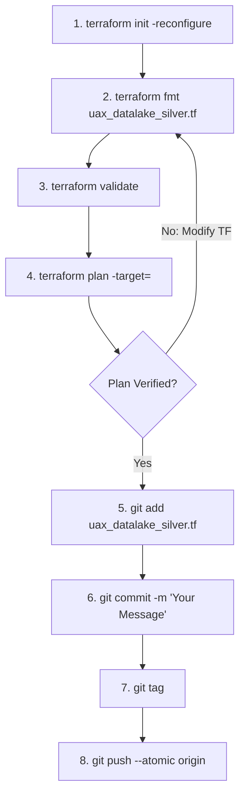
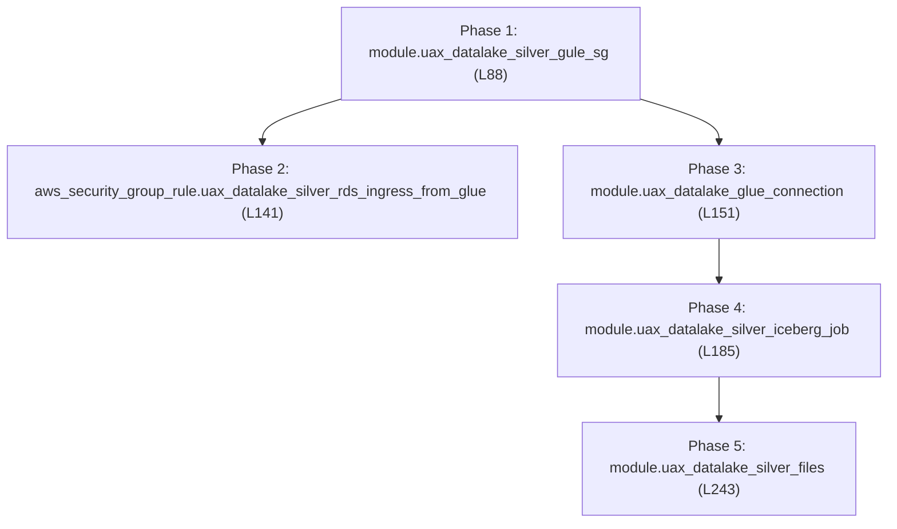

# Terraform Deployment Runbook — Silver Layer (`uax_datalake_silver.tf`)

## 1. Executive Summary & Purpose

This document serves as the production-grade deployment runbook for the **Silver Layer Infrastructure as Code (IaC)** defined in `uax_datalake_silver.tf`.

The configuration resides within the enterprise infrastructure repository (maintained in parallel to the `Data-pipeline` repository) and provisions the complete AWS foundation required for Silver Layer conformed entity processing:
* **VPC Networking & Security Groups**: Dedicated AWS Glue Security Group (`uax_datalake_silver_gule_sg`) controlling outbound connectivity to S3 VPC endpoints, AWS Secrets Manager, and RDS Aurora subnets.
* **Database Ingress Governance**: Explicit Security Group Ingress Rule (`aws_security_group_rule.uax_datalake_silver_rds_ingress_from_glue`) granting Glue compute network access to downstream RDS / Aurora database ports.
* **Glue VPC Network Connection**: AWS Glue Connection (`uax_datalake_glue_connection`) enabling the PySpark ETL job to run within enterprise private subnets.
* **Apache Iceberg Processing Engine**: AWS Glue PySpark job (`uax_datalake_silver_iceberg_job`) configured with Apache Iceberg Spark extensions/catalogs for deduplication, schema evolution, and SCD type-1/type-2 conformance.
* **Deployment Artifacts**: S3 object deployment of Silver transformation scripts (`uax_silver_etl.py`, `transformer.py`, `silver_config_loader.py`), domain custom transforms, and `silver_config.json`.

---

## 2. Developer Environment & Terminal Setup

All Terraform modifications and deployments must be executed through **Git Bash** on a properly authenticated terminal session. Follow this standard pre-flight setup:

### Step 1: Clone Repository & Switch Branch
```bash
# Clone the infrastructure repository
git clone <repository_url>

# Navigate into the cloned project root
cd <repository_folder>

# Fetch latest remote refs and switch to your feature/deployment branch
git fetch origin
git checkout <branch_name>
git pull origin <branch_name>
```

### Step 2: Open Project in VS Code
From the cloned repository directory:
```bash
# Launch VS Code in the current directory
code .
```

### Step 3: Launch Integrated Git Bash Terminal
1. Inside VS Code, press <kbd>Ctrl</kbd> + <kbd>`</kbd> (or go to **Terminal** $\to$ **New Terminal**).
2. Click the dropdown arrow next to the `+` icon on the terminal tab and select **Git Bash**.
3. Verify your Terraform CLI installation and version:
   ```bash
   terraform -version
   ```

---

## 3. Production Deployment SOP (Standard Operating Procedure)

For every infrastructure change to `uax_datalake_silver.tf`, adhere strictly to the following 8-step lifecycle. **Do not run global applies without targeted plan verification.**



### Step 1: Reconfigure Terraform Backend
Synchronizes the state backend, S3 remote state lock DynamoDB table, and provider plugins:
```bash
terraform init -reconfigure
```

### Step 2: Format Terraform Code
Enforces canonical HCL formatting and indentation:
```bash
terraform fmt uax_datalake_silver.tf
```

### Step 3: Validate Configuration Syntax
Verifies syntactic validity and schema correctness:
```bash
terraform validate
```

### Step 4: Targeted Plan Verification
Target only the specific module or resource being deployed or updated:
```bash
# For modules:
terraform plan -target=module.<module_name>

# For standalone resources (e.g. security group rule):
terraform plan -target=aws_security_group_rule.<resource_name>
```
> [!IMPORTANT]
> Review the resource diff (`+ create`, `~ update in-place`, `- destroy`). Ensure network security groups or Glue connections are not flagged for unexpected replacement.

### Step 5: Stage Modified File
```bash
git add uax_datalake_silver.tf
```

### Step 6: Semantic Git Commit
Commit using standard semantic commit messages:
```bash
git commit -m "feat(silver): deploy <component_name> for silver iceberg processing"
```

### Step 7: Create Deployment Release Tag
Tag the commit using your standard tag name format to trigger execution in the Terraform Registry:
```bash
git tag <tagname>
```

### Step 8: Atomic Push (Branch + Tag)
Pushes both the commit and release tag in a single atomic transaction:
```bash
git push --atomic origin <branch> <tagname>
```

---

## 4. Component & Resource Catalog (`uax_datalake_silver.tf`)

`uax_datalake_silver.tf` encapsulates **4 modules** and **1 standalone security group resource** across lines 88 to 243. Below is the master resource catalog:

| Line # | Resource / Module Identifier | Type | AWS Resource / Service | Primary Architectural Purpose |
| :---: | :--- | :---: | :--- | :--- |
| **L88** | `module "uax_datalake_silver_gule_sg"` | Module | AWS Security Group (`aws_security_group`) | Glue VPC Security Group (`gule_sg`) controlling outbound network egress for Glue workers. |
| **L141** | `resource "aws_security_group_rule" "uax_datalake_silver_rds_ingress_from_glue"` | Resource | AWS Security Group Rule (`aws_security_group_rule`) | Ingress firewall rule allowing Glue compute instances into the downstream RDS / Aurora database security group. |
| **L151** | `module "uax_datalake_glue_connection"` | Module | AWS Glue Connection (`aws_glue_connection`) | Network connection configured with VPC subnet IDs and `uax_datalake_silver_gule_sg` for private VPC execution. |
| **L185** | `module "uax_datalake_silver_iceberg_job"` | Module | AWS Glue Job (`aws_glue_job`) | Main PySpark ETL batch job running `uax_silver_etl.py` with Apache Iceberg extensions and catalog configs. |
| **L243** | `module "uax_datalake_silver_files"` | Module | Amazon S3 Objects (`aws_s3_object`) | Deploys runtime script files (`uax_silver_etl.py`, `transformer.py`, `silver_config_loader.py`, `silver_config.json`) to S3. |

---

## 5. Phased Deployment & Dependency Order

Execute modules and resources in their strict **dependency sequence** using the targeted plan commands below:



### Phase 1 — Glue Network Security Group
Provisions the security group for Glue workers in the private VPC:
```bash
terraform plan -target=module.uax_datalake_silver_gule_sg
```

### Phase 2 — RDS Database Ingress Security Rule
Attaches the ingress rule allowing the Glue security group into the RDS / Aurora database port:
```bash
terraform plan -target=aws_security_group_rule.uax_datalake_silver_rds_ingress_from_glue
```

### Phase 3 — Glue Network Connection
Provisions the AWS Glue VPC network connection binding the Glue security group to private subnets:
```bash
terraform plan -target=module.uax_datalake_glue_connection
```

### Phase 4 — Silver Iceberg ETL Compute Engine (Glue Job)
Provisions the AWS Glue job definition with allocated DPUs, Iceberg Spark runtime configurations, and network connection attachments:
```bash
terraform plan -target=module.uax_datalake_silver_iceberg_job
```

### Phase 5 — Silver Code Artifact Deployments
Uploads the executable PySpark ETL scripts, transformer modules, and JSON configurations to S3:
```bash
terraform plan -target=module.uax_datalake_silver_files
```

---

## 6. Production Safety Rules & Engineering Standards

1. **Targeted Plans Prevent Inadvertent Blast Radius**:
   - In shared cloud environments, running an un-targeted `terraform plan` can pick up drift on un-related resources. Always isolate updates using `-target=module.<name>` or `-target=aws_security_group_rule.<name>`.
2. **Security Group Rule Ingress Scoping**:
   - Ensure `aws_security_group_rule.uax_datalake_silver_rds_ingress_from_glue` uses source security group references (`source_security_group_id`) rather than broad CIDR blocks (`0.0.0.0/0`) to guarantee strict network boundary isolation.
3. **Atomic Git Push (`--atomic`)**:
   - Always push commits and release tags together via `git push --atomic origin <branch> <tagname>`. This prevents CI/CD pipelines from triggering on commits before release tags are recorded.
4. **Tagging Convention**:
   - Always format release tags using your organization's standard tag name format. Pushing the tag with your commit triggers automated pipeline execution in the Terraform Registry.
